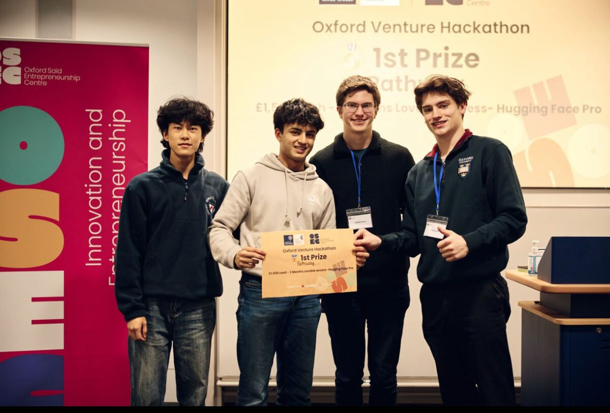
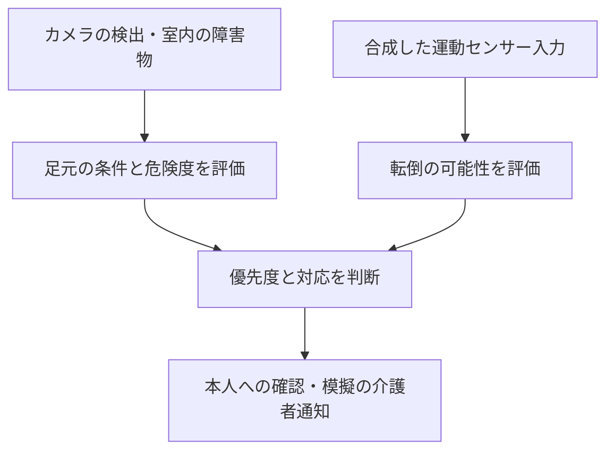

<p align="right"><a href="README.md">English</a> | <strong>日本語</strong></p>

# Pathway

### 🏆 Oxford Venture 2026 Hackathon 優勝

**参加者115人の大会で、初対面の4人が36時間で開発。**

古いスマートフォンを歩行器に取り付け、足元の障害物を検出し、転倒の可能性があったときに介護者へ知らせられないか。その問いから始まったプロジェクトです。

[**ブラウザーデモを試す**](https://jsmitty78.github.io/Pathway-Oxford1stPlaceHackathon/) · [**写真付きの全編ストーリー**](docs/HACKATHON_STORY.ja.md) · [当時の動画](README.md#original-hackathon-footage) · [技術仕様の全編](README.md)



*会場で出会い、36時間後に優勝したチーム。*

## 最初に知っていただきたいこと

このリポジトリでは、ハッカソンの試作を**後から再構築したブラウザーデモ**を動かせます。当時のPython危険物検出器は元の判定ルールとともに残っていますが、元のiOSソースはありません。JavaScriptの判定エンジンは後から再構築し、27件のテストを用意しています。[当時の成果と再構築の区別](docs/HACKATHON_STORY.ja.md)を詳しく説明しています。

現在の[iPhone 15 Pro向けSwiftUI実装案](https://github.com/Jsmitty78/Pathway-Oxford1stPlaceHackathon/pull/1)は新しい実装です。シミュレータービルドとコアのテスト7件は成功していますが、モデルの導入と実機確認は残っています。

## 36時間の中で取り組んだこと

街頭で32人に話を聞き、屋内の障害物に焦点を絞りました。歩行器が借りられず、午前2時ごろに友人の友人からラクロスのスティックを、午前3時ごろには別の友人から3Dプリンターを借りました。クリップを設計し、即席のフレームにスマートフォンを固定してテストしました。

Saïd Business Schoolの近くで試し、発表ではフレームを倒して転倒を模擬し、チームの電話への実際の着信を見せました。元の記録では連絡のすべての段階が自動か確認できません。ブラウザーデモでは連絡を模擬し、実際のSMS・通話は送りません。

私は調査、実機統合、テスト、ピッチを担当しました。Caleb Byrne、Antony He、Aiyush Guptaとの共同開発です。受賞、Keble Collegeでのお祝い、J-StarXでの新しい友人との時間まで、[全編の日本語ストーリー](docs/HACKATHON_STORY.ja.md)に写真とともに残しています。

## 動作を試す

ブラウザーデモはビルド不要です。ホスト版を開くか、Node.js **22以降**でローカル起動します。

```sh
git clone https://github.com/Jsmitty78/Pathway-Oxford1stPlaceHackathon.git
cd Pathway-Oxford1stPlaceHackathon
npm start
```

`http://localhost:5173`を開きます。依存パッケージのインストールは不要です。録画の再生に必要なHTTP Rangeに対応するため、付属のサーバーを使用してください。

```sh
npm run check
```

構文と27件の合成シナリオのテストを確認します。実際の人の転倒検出精度やカメラの精度を測定するものではありません。

## 仕組みを見る



| 確認する内容 | 資料・コード |
|---|---|
| 全体構成、センサー、処理の流れ | [ARCHITECTURE.md](docs/ARCHITECTURE.md) |
| しきい値、重み、優先度の技術判断 | [TECHNICAL_DECISIONS.md](docs/TECHNICAL_DECISIONS.md) |
| 当時のコードと再構築した部分 | [RECONSTRUCTION_NOTES.md](docs/RECONSTRUCTION_NOTES.md) |
| 当時のPython検出器 | [hazard_detector.py](vision/hazard_detector.py) |
| ブラウザーの判定エンジン | [pathwayEngine.js](src/pathwayEngine.js) |
| 合成シナリオとテスト | [サンプル](data/sampleEvents.js) · [テスト](test/hazardEngine.test.js) |
| 次の開発計画 | [ROADMAP.md](docs/ROADMAP.md) |
| 元の動画・画像の扱い | [assets/README.md](assets/README.md) |

元の英語READMEには、当時の市場数値、費用の仮定、数式、全ファイルの説明、動画をそのまま保存しています。この日本語ページは入口であり、詳細な開発記録は[全編ストーリー](docs/HACKATHON_STORY.ja.md)、数式を含む仕様は[元の技術資料](README.md)から確認できます。

Pathwayは医療機器ではなく、臨床検証も行っていません。転倒の危険がある方の安全を、この試作に依存させることはできません。
