<div align="center">

# Pathway

**Turning a walking frame the user already owns, and a smartphone already in a drawer,
into a fall-prevention and caregiver-alert system.**

### 🏆 1st Place, Oxford Venture 2026 Hackathon

Selected from a field of 115 participants · built in 36 hours by a team that met at the event

[](https://github.com/Jsmitty78/Pathway-Oxford1stPlaceHackathon/actions/workflows/ci.yml)
[](test/hazardEngine.test.js)
[](LICENSE)
[](#run-the-demo)

[Run the demo](#run-the-demo) · [The 36-hour build story](docs/HACKATHON_STORY.md) ·
[Architecture](docs/ARCHITECTURE.md) · [Technical decisions](docs/TECHNICAL_DECISIONS.md) ·
[Reconstruction notes](docs/RECONSTRUCTION_NOTES.md) · [Roadmap](docs/ROADMAP.md)

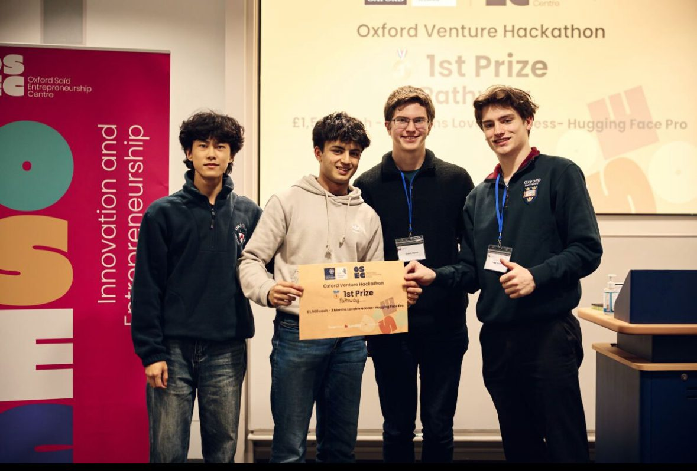

<sub><b>The team after winning 1st place in a field of 115 participants.</b><br>
Four strangers at the start of the hackathon. One first-place team 36 hours later.</sub>

</div>

> [!NOTE]
> **This repository is a reconstructed, runnable portfolio version of the original hackathon
> prototype.** The original iOS app did not survive the event. The surviving Python hazard
> detector is here unchanged; the decision engine around it was rebuilt in JavaScript and is
> covered by 27 tests. Exactly what is original and what is rebuilt is listed in
> [Original versus reconstructed](#original-versus-reconstructed).

---

## The problem

- **220,000** UK A&E admissions in 2024 were caused by falls — *NICE*
- Falls are the **leading cause of injury-related death** in over-65s: 38,000+ deaths in 2021 — *US CDC*
- Falls cost the NHS around **£2.3 billion** a year — *NHS England*

The tools that exist are either free and unintelligent, or intelligent and unaffordable. The
NHS hands out walking frames for nothing. The one competing smart walker starts at **$2,499**
plus a $50/month subscription, and six years after founding it still is not shipping.

And the risk is mostly indoors. From 32 interviews around Oxford: most walker users stay
inside, and the biggest danger is the rug edge, the door threshold, the bag left in the
hallway.

> *"My **biggest fear** isn't falling myself; it's my parents falling when **no one's there
> to catch them**."*
> — Sarah, 42, from Oxfordshire · quoted from the pitch deck

## The solution

Clamp a **repurposed old phone** to the crossbar of a frame the user already has. That is
the whole hardware story — the deck puts the marginal cost at **£0.24**, roughly 10⁴× cheaper
than the alternative, and it is one fewer phone in landfill.

The phone then does four things:

| | |
|---|---|
| **Sees the floor** | On-device object detection flags what is actually underfoot, filtering out the sofa you walk around and the mug on the worktop |
| **Remembers the room** | A persistent environment map keeps fixed hazards — rug lips, raised thresholds — between passes |
| **Feels a fall** | Angular acceleration, impact and post-event stillness, scored together |
| **Pulls someone in** | An on-screen prompt with a way out, then a text with a location pin, then a call |

<table>
<tr>
<td width="33%">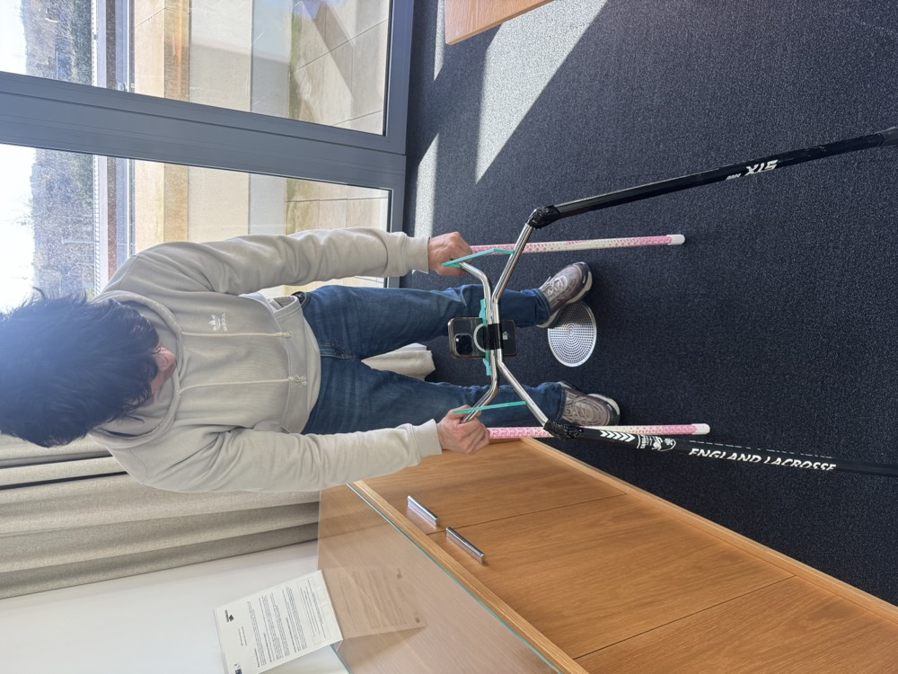<br><sub><b>The rig.</b> A printed mount on a frame improvised from lacrosse sticks.</sub></td>
<td width="33%">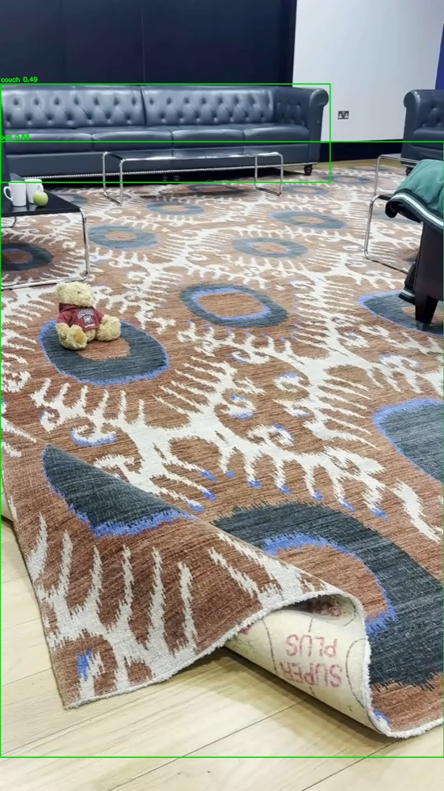<br><sub><b>Original demo footage.</b> Live detection, hackathon build.</sub></td>
<td width="33%">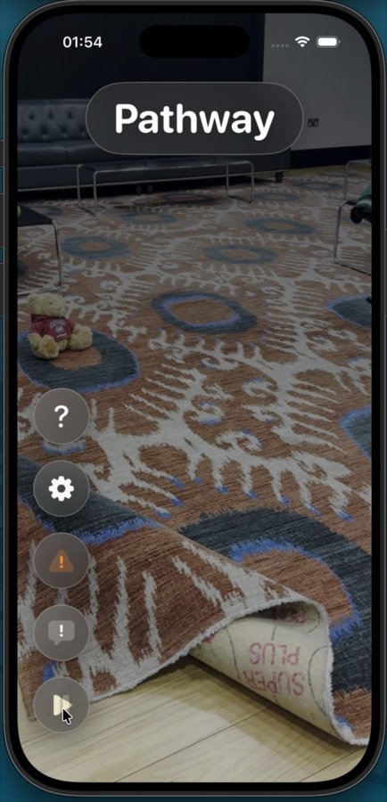<br><sub><b>The app.</b> One pill, one rail of large buttons.</sub></td>
</tr>
</table>

---

## Built in 36 hours

Jake Smith, Caleb Byrne, Antony He and Aiyush Gupta met for the first time at the Oxford
Venture 2026 Hackathon. There was no pre-existing team and no idea agreed in advance — they
formed the team on site, chose the problem together, and took Pathway from a blank whiteboard
to a first-place working prototype in the following 36 hours.

Pathway was not built with ideal laboratory equipment. It was built overnight from whatever
the team could reach.

<details open>
<summary><b>The 36-hour timeline</b></summary>

<br>

| | |
|---|---|
| **Hour 0** | Four strangers form a team, pick older-adult falls, and start on the whiteboard |
| **Hours 3–8** | Out into Oxford: **32 interviews** with members of the public. **68%** knew an older adult who had fallen in the past year. The finding that most walker users stay *indoors* moves indoor hazard detection from a feature to the core of the product |
| **In parallel** | **Four care homes** contacted; **two expressed interest** in a follow-up test or a scheduled demonstration. **Two elderly-care experts** also expressed interest |
| **Hardware problem** | A retrofit needs something to retrofit. **Three hospitals and Oxford medical contacts** were asked about borrowing a walking frame. It was the weekend; none could be released in time |
| **The workaround** | Rather than drop the hardware demonstration, the team improvised a frame from **old lacrosse sticks and duct tape** — enough to hold the phone at a realistic height and be tipped over on purpose |
| **~02:00** | A friend agreed to lend the team a **3D printer**. The team walked roughly **45 minutes** to collect it, carried it back, then designed and printed a smartphone holder for the frame |
| **Through the night** | Mount, walk the frame at hazards, tip it over, check what fired, adjust, repeat |
| **Hour 36** | Final pitch — and the live fall demonstration below |

</details>

The improvised frame is exactly that: **a hackathon rig, not production hardware.** Nothing
about its geometry, stability or materials has been validated against a real walking frame.

> **Read the full 36-hour build story → [docs/HACKATHON_STORY.md](docs/HACKATHON_STORY.md)**

### From the hackathon

<table>
<tr>
<td width="33%">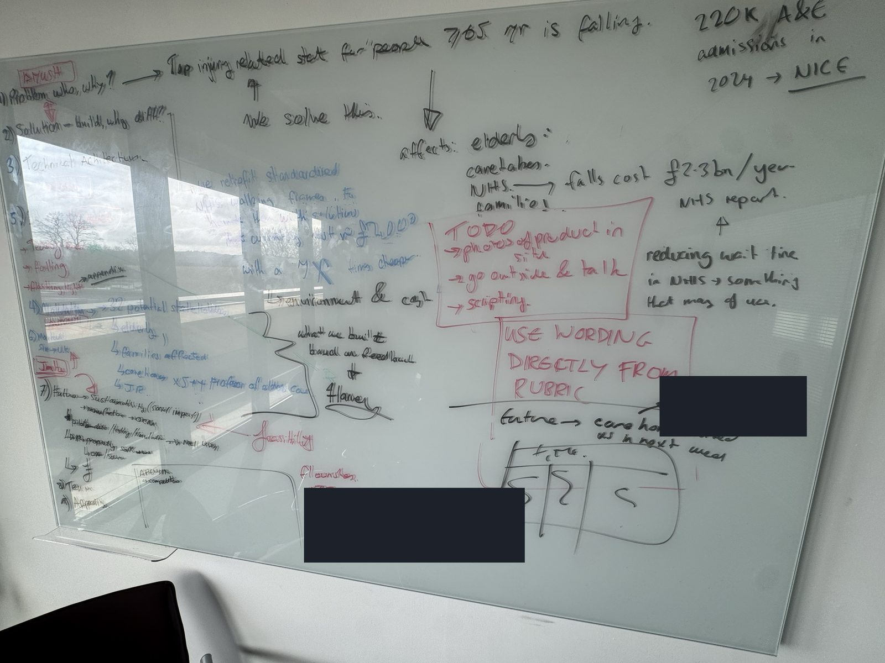</td>
<td width="33%">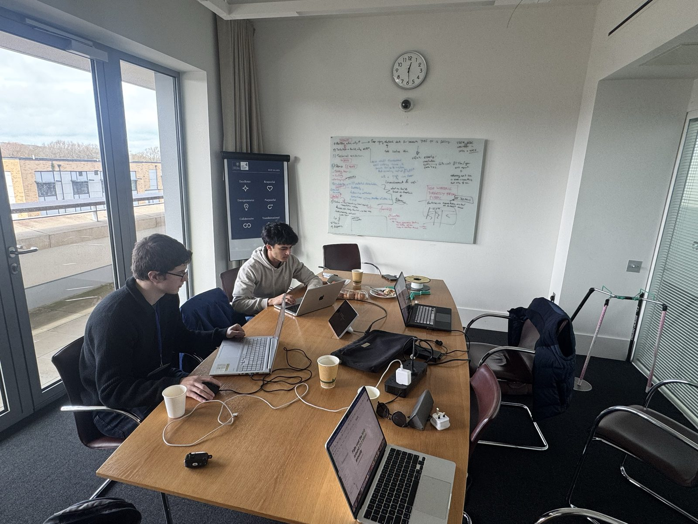</td>
<td width="33%">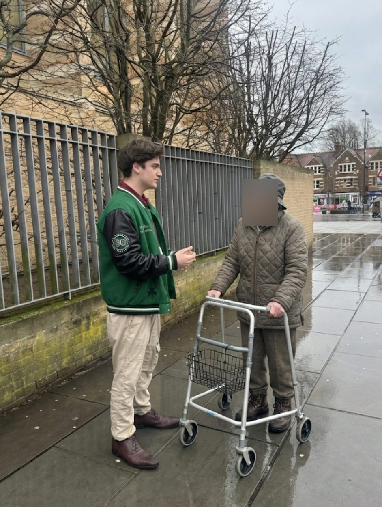</td>
</tr>
<tr>
<td><sub><b>Mapping the problem</b> during the whiteboard session.</sub></td>
<td><sub><b>Building through the night</b> after forming the team at the event.</sub></td>
<td><sub><b>Speaking with members of the public</b> about older-adult falls.</sub></td>
</tr>
<tr>
<td>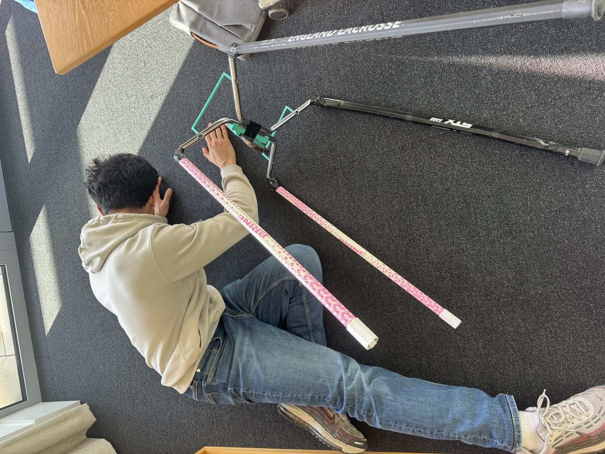</td>
<td>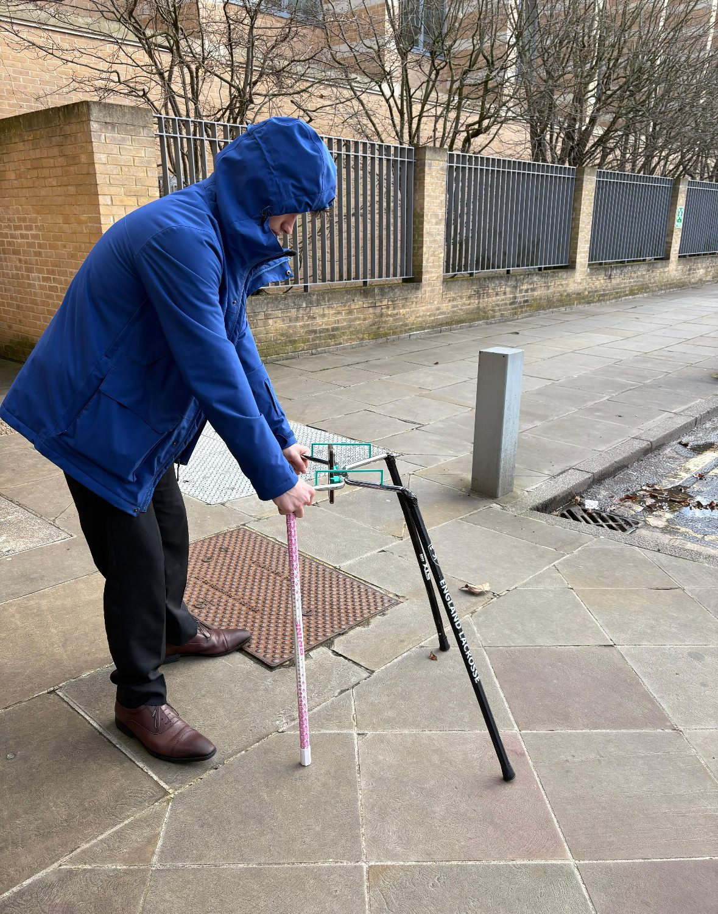</td>
<td>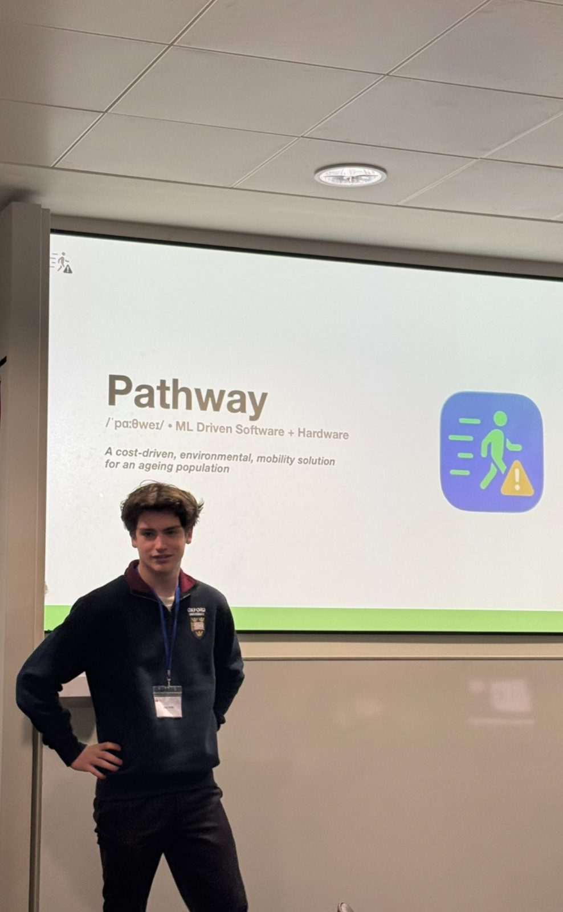</td>
</tr>
<tr>
<td><sub><b>Building the improvised frame</b> for the simulated-fall tests.</sub></td>
<td><sub><b>Testing the improvised walker prototype</b> outdoors in Oxford.</sub></td>
<td><sub><b>Presenting the final Pathway prototype</b> to the judges.</sub></td>
</tr>
</table>

<div align="center">
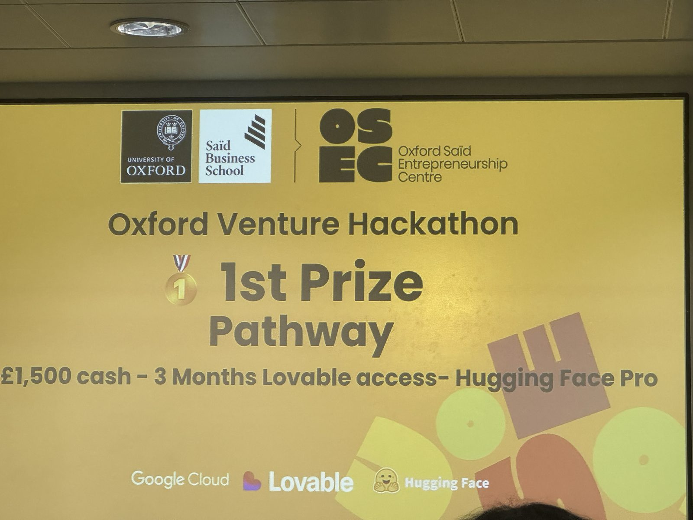<br>
<sub><b>The first-place result announced at the Oxford Venture 2026 Hackathon.</b></sub>
</div>

Photograph provenance, including two privacy redactions, is documented in
[assets/README.md](assets/README.md).

---

## The original live demonstration

In the final presentation, the team triggered a simulated fall by **tipping the prototype
over in front of the judges**. Pathway detected the event and initiated the escalation
workflow, **placing a real phone call to the team's phone, live in the room.**

The demonstration showed that the detection-to-contact loop could run end to end — it was not
only a visual mock-up — while remaining a hackathon prototype rather than a clinically
validated safety system.

> [!IMPORTANT]
> That call happened during the **original hackathon demo**, on the team's own phone and
> contacts. **The browser demo in this repository simulates the escalation flow and is not
> connected to any live SMS or voice service.** No real phone number, address or contact name
> appears anywhere in this repository.

<details>
<summary><b>Why it won</b></summary>

<br>

Four things the judges could check on the day, all of which are documented here:

- **A real end-to-end loop, not a slideshow.** The fall was simulated physically and the
  escalation ended in a phone call ringing in the room.
- **Field evidence behind the product decisions.** 32 interviews around Oxford, and a
  specific finding — walker users are mostly indoors — that visibly changed what was built.
- **A cost argument that was hard to argue with.** A free frame plus a phone that already
  exists, against a $2,499 competitor that had not shipped in six years.
- **Hardware that existed.** Improvised from lacrosse sticks and a borrowed 3D printer, but
  physically present, mounted and demonstrable rather than described.

</details>

---

## Original hackathon footage

These recordings were captured during the original Oxford Venture 2026 Hackathon build. They
show the surviving computer-vision detector, the iPhone interface, floor-hazard filtering and
the incident log that existed before the reconstructed browser demo in this repository.

**The original iOS source did not survive the hackathon, but video evidence of it did.**

> [!NOTE]
> Everything in this section is **original hackathon footage**, not a recording of the
> reconstructed demo. Clips open in the browser — H.264, no audio, 0.4–6.7 MB each — sized to stay inside GitHub's file-preview limit.

<table>
<tr>
<td width="50%">
<a href="assets/videos/original-live-object-detection.mp4">
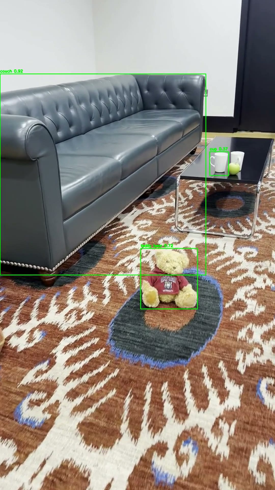
</a>
<br>
<sub><b>1 · Live object detection.</b> The surviving detector recognises objects in the camera feed and renders bounding boxes over the test environment. Nothing is judged yet — the couch and the soft toy are equally just objects.</sub>
</td>
<td width="50%">
<a href="assets/videos/original-floor-hazard-detection.mp4">
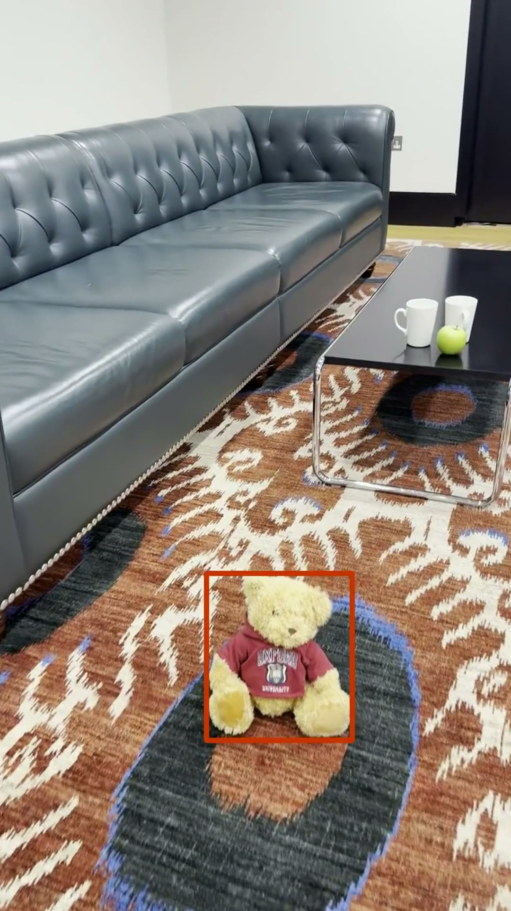
</a>
<br>
<sub><b>2 · Floor-hazard filtering.</b> The teddy bear is first recognised as an object and then promoted to a likely floor hazard. The couch, the mugs and the table are filtered out entirely — the rule <code>classifyDetection()</code> ports.</sub>
</td>
</tr>
<tr>
<td width="50%">
<a href="assets/videos/original-pathway-ios-app.mp4">
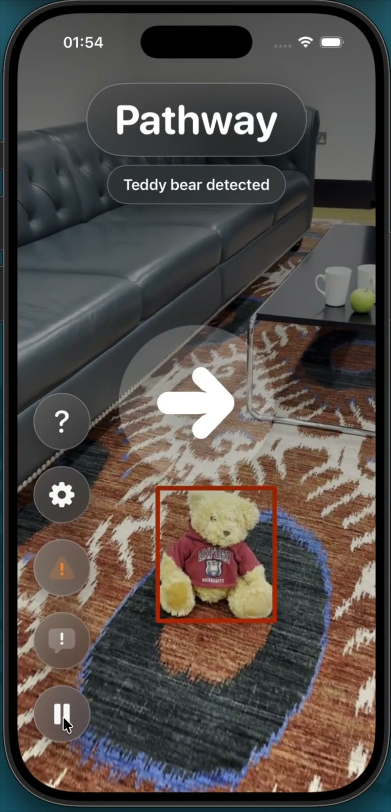
</a>
<br>
<sub><b>3 · The original Pathway iPhone app.</b> The interface shows the camera view, the rail of large accessibility-focused controls, a steer arrow and hazard toasts — "Rug detected", then "Teddy bear detected".</sub>
</td>
<td width="50%">
<a href="assets/videos/original-incident-log.mp4">
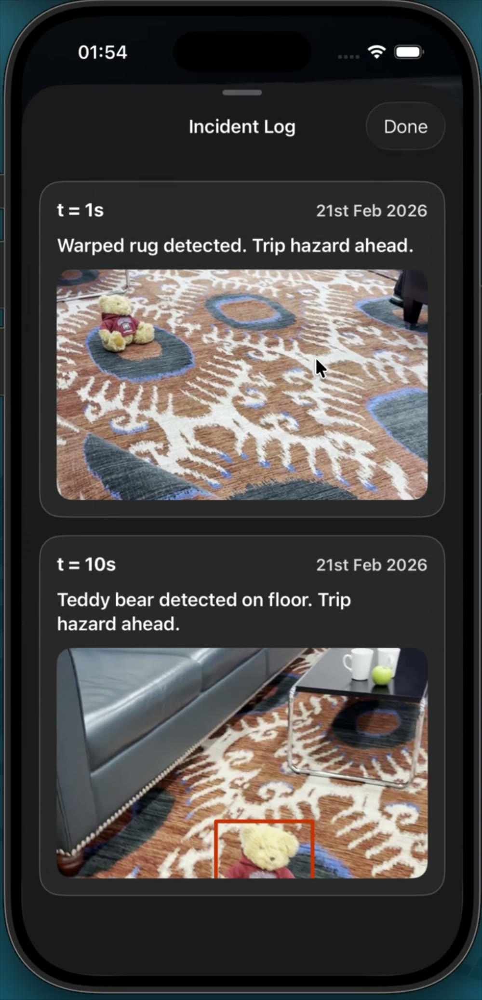
</a>
<br>
<sub><b>4 · The original incident log.</b> The app records detected hazards — a curled rug edge at <code>t = 1s</code> and a floor obstacle at <code>t = 10s</code> — each with a captured still and a timestamp.</sub>
</td>
</tr>
</table>

<sub>The app clip is a simulator recording driven from a recorded walkthrough, which is why it
opens on a "demo video" card; the interface, overlays and log are the real app. Full
per-clip provenance in <a href="assets/README.md">assets/README.md</a>.</sub>

### The full final pitch

<a href="assets/videos/thumbnails/original-final-pitch.jpg">
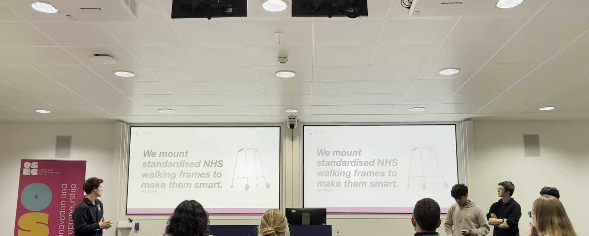
</a>

**Watch the original first-place final pitch** — *presented at the Oxford Venture 2026
Hackathon.* The complete pitch delivered to the judges, including the live demonstration.

<!--
  PITCH VIDEO LINK — intentionally not published yet.

  FinalPitchDemo.MOV (553 MB, 7m56s) is git-ignored and is NOT hosted anywhere, because the
  projected slides show a real mobile number and contact name (~238-262s), a named third
  party with their photograph (~100-135s), and a named care home (~320-460s).

  Once a redacted copy exists and has been uploaded, replace the  above with:
      <a href="THE_URL"></a>
  See the "Full pitch" section of assets/README.md for the exact timecodes to redact.
-->

> [!IMPORTANT]
> The full pitch recording is **not published yet.** The projected slides show a real phone
> number, a named individual and a named care home, so it is withheld until those are
> redacted. The still above is from a frame containing none of them.

---

## Oxford field validation

Within the same 36 hours, the team did not rely on online research alone. They left the venue
and interviewed members of the public on the streets of Oxford.

| | |
|---|---|
| **32** | interviews with members of the public around Oxford |
| **68%** | knew an older adult who had fallen in the previous year |
| **4** | care homes contacted; **2** expressed interest in a follow-up test or a scheduled demonstration |
| **2** | elderly-care experts expressed interest |

Neither care home became a formal partner and no trial was agreed. The figures are reported
as the team presented them and are not independently verified in this repository.

Three findings changed the build:

- **Most walker users stay indoors** → indoor hazard detection became the core of the
  product, not an add-on, and the outdoor pedestrian branch was descoped
- **Caregivers want to be in the loop** → every event ends in a triage decision, not a
  silent log
- **Technology can be difficult for elderly users** → one pill, one rail of large buttons,
  and a full-screen confirmation with an equally prominent way out

Market sizing, competitive analysis and ICPs are summarised in
[docs/PITCH_DECK_SUMMARY.md](docs/PITCH_DECK_SUMMARY.md).

---

## Reuse rather than replacement

Pathway explores whether existing hardware can be reused rather than replaced.

A **standard walking frame the user already owns** can be retrofitted — nothing needs to be
manufactured to replace it. A **retired smartphone** already contains a camera, an
accelerometer, a gyroscope, connectivity and compute, which makes it a practical platform for
a low-cost assistive retrofit rather than a device to be built from scratch.

Two consequences follow. It could reduce the need to manufacture an entirely new smart
mobility device for each user, and it creates a use for phones that would otherwise sit
unused in a drawer or become electronic waste.

The pitch deck cites that 40.4% of people replace their phone every two to three years and
that over five billion phones are discarded worldwide each year. **No environmental impact
has been measured for Pathway itself**, and none is claimed here — this is a design direction,
not a quantified result.

---

## Run the demo

No dependencies, no build step.

```bash
git clone <this-repo> && cd Pathway
npm start          # serves on http://localhost:5173
```

Then open <http://localhost:5173>. It does need to be served rather than opened from disk:
the demo is plain ES modules, and browsers block module imports over `file://`.

`npm start` runs [`scripts/serve.mjs`](scripts/serve.mjs) — about 80 lines of Node standard
library, no dependencies. Any static server works for the demo itself, but one that supports
**HTTP range requests** is needed for the [hackathon footage](#original-hackathon-footage) to
play; `npx serve` does, and `python3 -m http.server` does not.

```bash
npm test           # 27 behavioural tests over the engine
npm run check      # syntax check + tests
```

Requires Node 18+ for the tests and the dev server. Nothing is installed — there are no
dependencies to install.

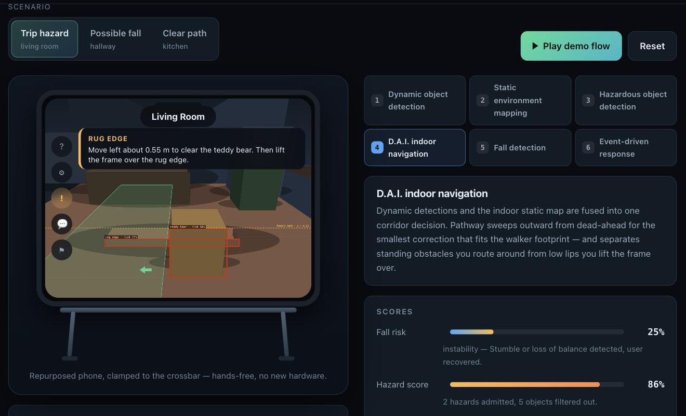

### What to try

1. **Press "Play demo flow."** It walks the six stages of the pitch-deck demo end to end,
   including the fall-confirmation takeover and the caregiver escalation.
2. **Drag "Distance walked toward the scene."** Objects grow and descend the frame as you
   approach. Watch the soft toy cross the hazard band and flip from tracked to flagged on
   its own — that is the ported admission rule firing on real geometry, not a scripted
   animation.
3. **Switch to "Clear path"** and drag the slider forward. The dining table becomes a
   hazard; the chair never does, because its top breaks the overhead rule.
4. **Open "Why objects were filtered out."** Every rejected detection, with the specific
   check it failed.
5. **On "Possible fall," press "Crisis averted"** during the countdown. Nothing is sent.

### The pitch-deck demo flow

The six stages map one-to-one onto the deck's demo section:

| # | Stage | What it shows |
|---|---|---|
| 1 | **Dynamic object detection** | Green boxes over everything recognised — the same colour the original Python script drew |
| 2 | **Static environment mapping** | Cyan wireframes over persistent room features, including hazards no COCO class covers |
| 3 | **Hazardous object detection** | The admission rule. Only survivors get the thick red box |
| 4 | **D.A.I. indoor navigation** | Corridor search, steer arrow, step-over instruction |
| 5 | **Fall detection** | Angular-acceleration trace and the six-signal breakdown |
| 6 | **Event-driven response** | Record → prompt → strobe → text → call, into the caregiver dashboard |

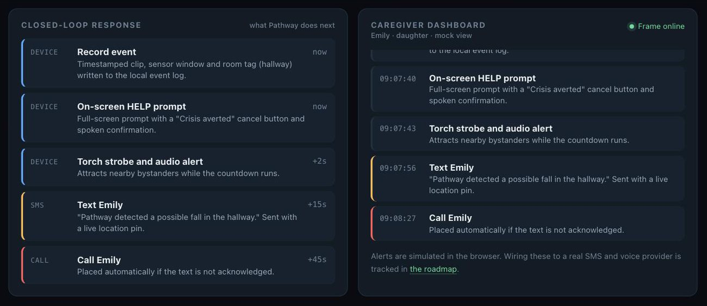

---

## Architecture

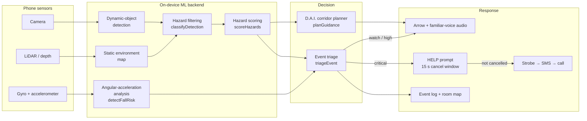

Full walkthrough in [docs/ARCHITECTURE.md](docs/ARCHITECTURE.md), including the original
architecture slide from the deck.

### Modules

| Function | Responsibility |
|---|---|
| `projectPoint` / `projectDetection` | Pinhole projection through a camera 0.92 m up, angled 20° down |
| `classifyDetection` | **Port of `isHazard()`** from the surviving Python detector |
| `scoreHazards` | Ranks admitted hazards on proximity, path alignment, class severity, confidence |
| `detectFallRisk` | Six weighted signals, led by angular acceleration |
| `planGuidance` | Corridor search: route around standing obstacles, step over low lips |
| `triageEvent` | Blends motion and scene evidence into an escalation ladder |
| `runPathway` | One full pass — what the demo renders and what the tests assert |

### Two decisions worth reading about

**The hazard filter is a verbatim port, not an improvement.** `classifyDetection()`
reproduces the original Python rule exactly — the same 0.65 and 0.15 frame thresholds, the
same `{person, bed, suitcase, couch}` ignore list, the same 0.5 confidence gate. Writing a
cleaner metric-space rule would have been easy and would have quietly cut the reconstruction
loose from the code that actually ran.

**Sample scenes are authored in metres, not pixels.** The hazard rule is about frame
position, so hand-placed boxes would make the demo circular — objects would be hazards
because someone typed coordinates that made them hazards. Going through the camera model
means the geometry decides, which is why walking forward changes the verdict.

More in [docs/TECHNICAL_DECISIONS.md](docs/TECHNICAL_DECISIONS.md).

---

## Tests

```
$ npm test
...
ℹ tests 27
ℹ pass 27
ℹ fail 0
```

They assert the claims the demo makes, through the same `runPathway()` entry point:

- A possible fall scores > 0.8 and reaches `fall-confirmed`
- A clear path scores < 0.25 and admits **zero** hazards
- The highest-risk hazard is ranked first in the triage queue
- Triage returns `critical` for fall events, and `critical` on motion evidence alone
- A critical event escalates to SMS **then** a call, always behind a cancel window
- A recovered stumble never places a call
- Ignored COCO classes never become hazards, in any scenario
- Elevated objects are filtered out even when close
- Walking toward an object moves it into the hazard band and flips the verdict
- Guidance steps over low lips, routes around standing obstacles, and `stop`s rather than
  inventing a route through a blocked corridor
- Both weight tables sum to 1, so a score reads as a fraction of maximum evidence
- Triage thresholds are ordered such that the levels cannot overlap

One of these caught a real bug during the rebuild: the deck describes the detector as
"angular acceleration driven", but impact initially carried the larger weight. The model
was corrected, not the test.

---

## Original versus reconstructed

This repository is rebuilt from the pitch deck and the surviving code. The split:

| | |
|---|---|
| ✅ **Original** | [`vision/hazard_detector.py`](vision/) — the live YOLO detector, 261 lines, three compatibility fixes marked inline. The deck, the architecture slide, the physical prototype and its printed mount, the live phone-call demonstration, the field interviews, the photographs in [`assets/hackathon/`](assets/hackathon), and the **footage in [`assets/videos/`](assets/videos)** — the detector, the hazard filter, the iOS app and its incident log, all recorded during the event. |
| 🔧 **Rebuilt** | The browser interface, the JavaScript scoring engine, the camera projection model, the synthetic motion scenarios, the triage model, the mock caregiver dashboard, the automated tests, and these docs. |
| ❌ **Still missing** | The iOS app **source** (SwiftUI + RoomPlan + CoreMotion), the original sensor recordings, the real production SMS/voice integration, the Core ML deployment code, and clinically validated fall thresholds. Every motion value in `data/sampleEvents.js` is synthesised because none survived. |

The videos are **evidence that the original implementation ran** — they are not a recovery of
it. The iOS source is still gone, and nothing in `assets/videos/` can be compiled, tested or
extended.

Every weight and threshold in the engine is an engineering judgement call, not a
measurement. Nothing here has been validated against a real fall.
[docs/RECONSTRUCTION_NOTES.md](docs/RECONSTRUCTION_NOTES.md) lists exactly which numbers are
reconstructed and which interpretations are inferences.

Reconstructed algorithms are never presented as original hackathon code — the distinction is
restated in [`vision/README.md`](vision/README.md), in
[RECONSTRUCTION_NOTES.md](docs/RECONSTRUCTION_NOTES.md) and in the demo itself.

**This is a hackathon prototype and a portfolio artefact. It is not a medical device and it
is not clinically validated.**

---

## Roadmap

The first milestone is not a feature — it is **recording real sensor traces**, so the fall
thresholds can be fitted instead of asserted. After that: a detector trained on floor
hazards COCO does not cover, temporal tracking, Core ML conversion, and rebuilding the iOS
app. Full plan, including the open questions that could invalidate the approach, in
[docs/ROADMAP.md](docs/ROADMAP.md).

## Repository layout

```
index.html                  the demo
src/
  pathwayEngine.js          decision core — pure, dependency-free, tested
  app.js                    demo controller and canvas renderer
  styles.css
scripts/serve.mjs           dev server — stdlib only, supports range requests
data/sampleEvents.js        three world-space scenarios
test/hazardEngine.test.js   27 tests
vision/
  hazard_detector.py        ORIGINAL hackathon detector
  requirements.txt
docs/                       story, architecture, decisions, reconstruction, roadmap, a11y
assets/                     stills recovered from the pitch deck
  hackathon/                photographs from the event
  videos/                   ORIGINAL hackathon footage + thumbnails
```

## Deploying the demo

It is a static site, so GitHub Pages works with no build step:

1. **Settings → Pages → Source: Deploy from a branch**
2. Branch `main`, folder `/ (root)`, save
3. It appears at `https://<user>.github.io/<repo>/` within a minute

All paths are relative, so it works from a subdirectory. Any static host does the same job.

## Accessibility

Every score is stated three ways — bar, number and sentence — because the users this exists
for are exactly the ones failed by information encoded in colour alone. The fall-risk bar
takes its colour from the detector stage rather than its value, so a 92% score never renders
green. Motion respects `prefers-reduced-motion`, focus is always visible, and the triage
message is an ARIA live region. Details and the known gaps in
[docs/ACCESSIBILITY.md](docs/ACCESSIBILITY.md).

## Team

The four team members met for the first time at the Oxford Venture 2026 Hackathon, formed the
team on site, and built Pathway together over the following 36 hours.

| | |
|---|---|
| **Jake Smith** | Concept & user research lead; hands-on prototype engineering, integration, testing, and demo troubleshooting |
| **Caleb Byrne** | Software architect |
| **Antony He** | CAD & market research |
| **Aiyush Gupta** | Product & strategy |

**Jake's contribution:** concept development, user research, and hands-on prototype engineering. I helped integrate the smartphone with the physical walker prototype, test the hazard-detection and fall-alert workflow, and troubleshoot issues ahead of the live demonstration. I also led customer discovery and contributed to the final pitch.

The work spanned user research and street interviews, software architecture, computer
vision, CAD and 3D printing, physical prototyping, market validation, and the final
presentation. No one part of it belongs to one person.

## Safety and clinical disclaimer

Pathway is a **hackathon prototype and a portfolio artefact**. It is **not a medical device**,
it has **not been clinically validated**, and it has never been tested against a real fall.
The fall-detection thresholds are engineering judgement, not fitted parameters. It cannot
prevent every fall, and it must not be relied on by anyone at risk of falling or by anyone
responsible for their care.

## Licence

[MIT](LICENSE) 

The pitch-deck stills and event photographs in `assets/` are the team's own material,
included to document the original prototype and the build. Two deck screenshots were
deliberately excluded because they contain a residential address and a personal phone
number; the demo recreates those screens with placeholder data. One published photograph has
a member of the public's face obscured and one has two text blocks redacted — both are
recorded in [assets/README.md](assets/README.md).
