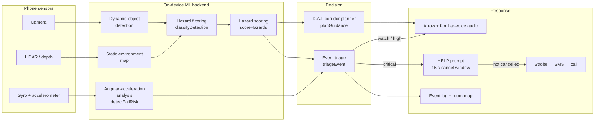

<div align="center">

# Pathway

**Turning a standard NHS walking frame into a fall-prevention system, using a phone that was already in a drawer.**

Oxford Venture 2026 Hackathon · reconstructed prototype

[Demo](#demo) · [Architecture](docs/ARCHITECTURE.md) · [Technical decisions](docs/TECHNICAL_DECISIONS.md) · [Reconstruction notes](docs/RECONSTRUCTION_NOTES.md) · [Roadmap](docs/ROADMAP.md)


</div>

---

## The problem

- **220,000** UK A&E admissions in 2024 were caused by falls — *NICE*
- Falls are the **leading cause of injury-related death** in over-65s: 38,000+ deaths in 2021 — *US CDC*
- Falls cost the NHS around **£2.3 billion** a year — *NHS England*

The tools that exist are either free and dumb, or smart and unaffordable. The NHS hands out
walking frames for nothing. The one competing smart walker starts at **$2,499** plus a
$50/month subscription, and six years after founding it still is not shipping.

And the risk is mostly indoors. From 32 interviews around Oxford: most walker users stay
inside, and the biggest danger is the rug edge, the door threshold, the bag left in the
hallway.

> *"My **biggest fear** isn't falling myself; it's my parents falling when **no one's there
> to catch them**."*
> — Sarah, 42, from Oxfordshire

## The solution

Clamp a **repurposed old phone** to the crossbar of a frame the user already has. That is
the whole hardware story: **£0.24 of unit cost**, roughly 10⁴× cheaper than the alternative,
and one fewer phone in landfill.

The phone then does four things:

| | |
|---|---|
| **Sees the floor** | On-device object detection flags what is actually underfoot, filtering out the sofa you walk around and the mug on the worktop |
| **Remembers the room** | A persistent environment map keeps fixed hazards — rug lips, raised thresholds — between passes |
| **Feels a fall** | Angular acceleration, impact and post-event stillness, scored together |
| **Pulls someone in** | An on-screen prompt with a way out, then a text with a location pin, then a call |

<table>
<tr>
<td width="33%"><br><sub><b>The rig.</b> A clamp on a frame improvised from lacrosse sticks.</sub></td>
<td width="33%"><br><sub><b>Original demo footage.</b> Live detection, hackathon build.</sub></td>
<td width="33%"><br><sub><b>The app.</b> One pill, one rail of large buttons.</sub></td>
</tr>
</table>

---

## Demo

No dependencies, no build step.

```bash
git clone <this-repo> && cd Pathway
npm start          # serves on http://localhost:5173
```

Then open <http://localhost:5173>. Any static server works — `npx serve`, `php -S`, a Live
Server extension. It does need to be served rather than opened from disk: the demo is plain
ES modules, and browsers block module imports over `file://`.

```bash
npm test           # 27 behavioural tests over the engine
npm run check      # syntax check + tests
```

Requires Node 18+ for the tests. The demo itself needs only a browser.

### What to try

1. **Press "Play demo flow."** It walks the six stages of the pitch-deck demo end to end,
   including the fall-confirmation takeover and the caregiver escalation.
2. **Drag "Distance walked toward the scene."** Objects grow and descend the frame as you
   approach. Watch the soft toy cross the hazard band and flip from tracked to flagged on
   its own — that is the ported admission rule firing on real geometry, not a scripted
   animation.
3. **Switch to "Clear path"** and drag the slider forward. The dining table becomes a
   hazard; the chair never does, because its top breaks the overhead rule.
4. **Open "Why objects were filtered out."** Every rejected detection, with the specific
   check it failed.
5. **On "Possible fall," press "Crisis averted"** during the countdown. Nothing is sent.

### The pitch-deck demo flow

The six stages map one-to-one onto the deck's demo section:

| # | Stage | What it shows |
|---|---|---|
| 1 | **Dynamic object detection** | Green boxes over everything recognised — the same colour the original Python script drew |
| 2 | **Static environment mapping** | Cyan wireframes over persistent room features, including hazards no COCO class covers |
| 3 | **Hazardous object detection** | The admission rule. Only survivors get the thick red box |
| 4 | **D.A.I. indoor navigation** | Corridor search, steer arrow, step-over instruction |
| 5 | **Fall detection** | Angular-acceleration trace and the six-signal breakdown |
| 6 | **Event-driven response** | Record → prompt → strobe → text → call, into the caregiver dashboard |


---

## Architecture



Full walkthrough in [docs/ARCHITECTURE.md](docs/ARCHITECTURE.md), including the original
architecture slide from the deck.

### Modules

| Function | Responsibility |
|---|---|
| `projectPoint` / `projectDetection` | Pinhole projection through a camera 0.92 m up, angled 20° down |
| `classifyDetection` | **Port of `isHazard()`** from the surviving Python detector |
| `scoreHazards` | Ranks admitted hazards on proximity, path alignment, class severity, confidence |
| `detectFallRisk` | Six weighted signals, led by angular acceleration |
| `planGuidance` | Corridor search: route around standing obstacles, step over low lips |
| `triageEvent` | Blends motion and scene evidence into an escalation ladder |
| `runPathway` | One full pass — what the demo renders and what the tests assert |

### Two decisions worth reading about

**The hazard filter is a verbatim port, not an improvement.** `classifyDetection()`
reproduces the original Python rule exactly — the same 0.65 and 0.15 frame thresholds, the
same `{person, bed, suitcase, couch}` ignore list, the same 0.5 confidence gate. Writing a
cleaner metric-space rule would have been easy and would have quietly cut the reconstruction
loose from the code that actually ran.

**Sample scenes are authored in metres, not pixels.** The hazard rule is about frame
position, so hand-placed boxes would make the demo circular — objects would be hazards
because someone typed coordinates that made them hazards. Going through the camera model
means the geometry decides, which is why walking forward changes the verdict.

More in [docs/TECHNICAL_DECISIONS.md](docs/TECHNICAL_DECISIONS.md).

---

## Tests

```
$ npm test
...
ℹ tests 27
ℹ pass 27
ℹ fail 0
```

They assert the claims the demo makes, through the same `runPathway()` entry point:

- A possible fall scores > 0.8 and reaches `fall-confirmed`
- A clear path scores < 0.25 and admits **zero** hazards
- The highest-risk hazard is ranked first in the triage queue
- Triage returns `critical` for fall events, and `critical` on motion evidence alone
- A critical event escalates to SMS **then** a call, always behind a cancel window
- A recovered stumble never places a call
- Ignored COCO classes never become hazards, in any scenario
- Elevated objects are filtered out even when close
- Walking toward an object moves it into the hazard band and flips the verdict
- Guidance steps over low lips, routes around standing obstacles, and `stop`s rather than
  inventing a route through a blocked corridor
- Both weight tables sum to 1, so a score reads as a fraction of maximum evidence
- Triage thresholds are ordered such that the levels cannot overlap

One of these caught a real bug during the rebuild: the deck describes the detector as
"angular acceleration driven", but impact initially carried the larger weight. The model
was corrected, not the test.

---

## Reconstruction

This repository is rebuilt from the pitch deck and the surviving code. The split:

| | |
|---|---|
| ✅ **Original** | [`vision/hazard_detector.py`](vision/) — the live YOLO detector, 261 lines, three compatibility fixes marked inline. The deck, the demo footage, the architecture slide. |
| 🔧 **Rebuilt** | The camera model, hazard scoring, fall detection, guidance, triage, the browser demo, the tests, these docs. |
| ❌ **Still missing** | The iOS app (SwiftUI + RoomPlan + CoreMotion), the real SMS/voice integration, and — most valuably — **recorded sensor traces**. Every motion value in `data/sampleEvents.js` is synthesised because none survived. |

Every weight and threshold in the engine is an engineering judgement call, not a
measurement. Nothing here has been validated against a real fall.
[docs/RECONSTRUCTION_NOTES.md](docs/RECONSTRUCTION_NOTES.md) lists exactly which numbers are
reconstructed and which interpretations are inferences.

**This is a hackathon prototype and a portfolio artefact. It is not a medical device and it
is not clinically validated.**

---

## Validation

From the pitch deck, reported as the team presented it:

| | |
|---|---|
| **32** | public interviews conducted around Oxford |
| **68%** | knew an adult who had fallen in the last year |
| **4** | care homes contacted; **2** interested in a scheduled demo |
| **2** | elderly-care experts expressed interest |

Three findings changed the build:

- **Most walker users stay indoors** → indoor hazard detection became the core of the
  product, not an add-on, and the outdoor pedestrian branch was descoped
- **Caregivers want to be in the loop** → every event ends in a triage decision, not a
  silent log
- **Technology can be difficult for elderly users** → one pill, one rail of large buttons,
  and a full-screen confirmation with an equally prominent way out

Market sizing, competitive analysis and ICPs are summarised in
[docs/PITCH_DECK_SUMMARY.md](docs/PITCH_DECK_SUMMARY.md).

---

## Roadmap

The first milestone is not a feature — it is **recording real sensor traces**, so the fall
thresholds can be fitted instead of asserted. After that: a detector trained on floor
hazards COCO does not cover, temporal tracking, Core ML conversion, and rebuilding the iOS
app. Full plan, including the open questions that could invalidate the approach, in
[docs/ROADMAP.md](docs/ROADMAP.md).

## Repository layout

```
index.html                  the demo
src/
  pathwayEngine.js          decision core — pure, dependency-free, tested
  app.js                    demo controller and canvas renderer
  styles.css
data/sampleEvents.js        three world-space scenarios
test/hazardEngine.test.js   27 tests
vision/
  hazard_detector.py        ORIGINAL hackathon detector
  requirements.txt
docs/                       architecture, decisions, reconstruction, roadmap, a11y
assets/                     stills recovered from the pitch deck
```

## Deploying the demo

It is a static site, so GitHub Pages works with no build step:

1. **Settings → Pages → Source: Deploy from a branch**
2. Branch `main`, folder `/ (root)`, save
3. It appears at `https://<user>.github.io/<repo>/` within a minute

All paths are relative, so it works from a subdirectory. Any static host does the same job.

## Accessibility

Every score is stated three ways — bar, number and sentence — because the users this exists
for are exactly the ones failed by information encoded in colour alone. The fall-risk bar
takes its colour from the detector stage rather than its value, so a 92% score never renders
green. Motion respects `prefers-reduced-motion`, focus is always visible, and the triage
message is an ARIA live region. Details and the known gaps in
[docs/ACCESSIBILITY.md](docs/ACCESSIBILITY.md).

## Team

Built at the Oxford Venture 2026 Hackathon by:

| | |
|---|---|
| **Jake Smith** | Concept & user research lead |
| **Caleb Byrne** | Software architect |
| **Antony He** | CAD & market research |
| **Aiyush Gupta** | Product & strategy |

## Licence

[MIT](LICENSE) © 2026 Caleb Byrne.

The pitch-deck stills in `assets/` are the team's own material, included to document the
original demo. Two screenshots from the deck were deliberately excluded because they contain
a residential address and a personal phone number; the demo recreates those screens with
placeholder data.
