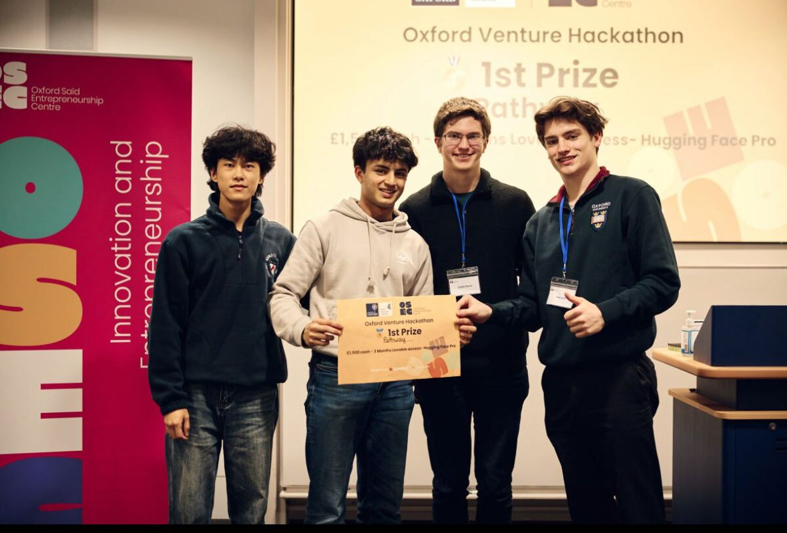
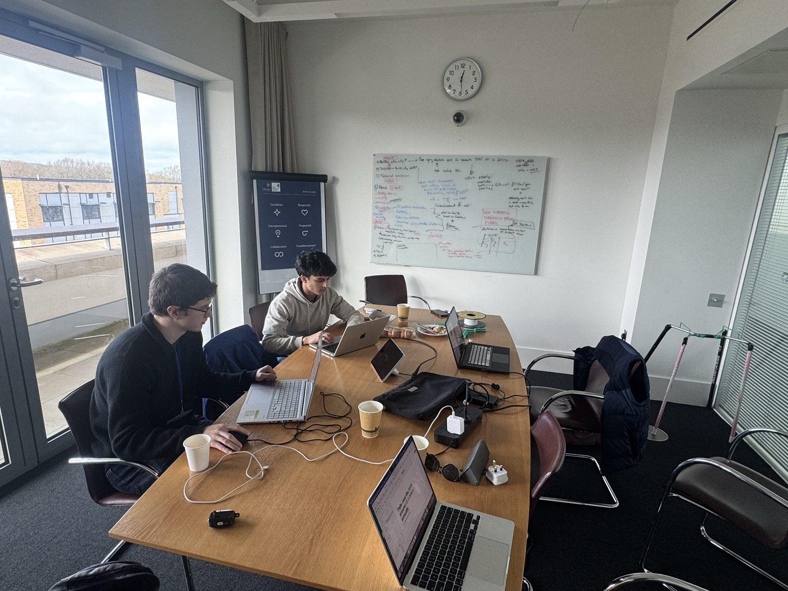
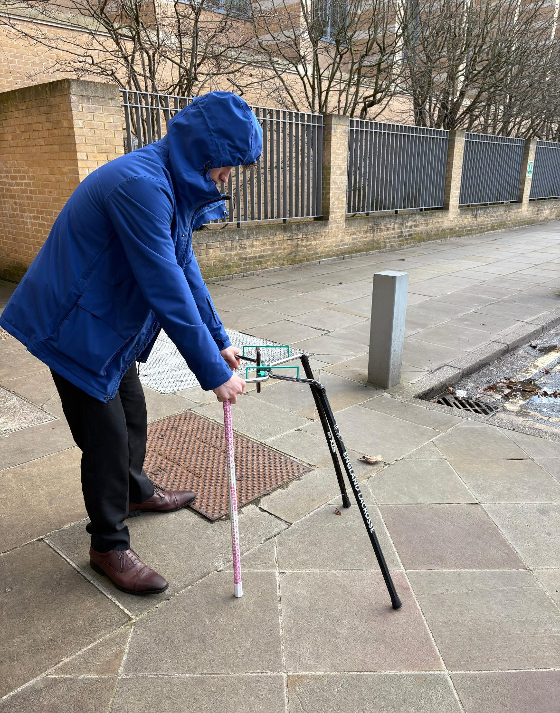
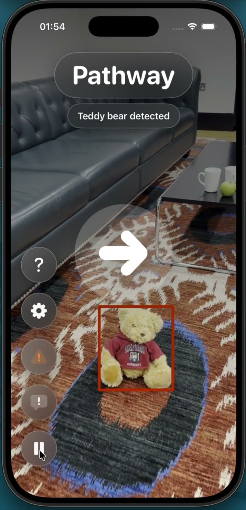

<div align="center">

# Pathway

### Smartphone-assisted mobility, built through research and resourcefulness

**1st Place · Oxford Venture 2026 Hackathon**
A 36-hour team project combining computer vision, physical prototyping and user research.

[](https://github.com/Jsmitty78/Pathway-Oxford1stPlaceHackathon/actions/workflows/ci.yml)
[](LICENSE)

[The Oxford story](docs/HACKATHON_STORY.md) · [Original footage](#original-hackathon-footage) · [Run the demo](#run-the-demo) · [Engineering](docs/ARCHITECTURE.md)



*Jake Smith · Caleb Byrne · Antony He · Aiyush Gupta*

</div>

## Project at a glance

Pathway explores how a smartphone attached to a walking frame could help identify possible obstacles and support a caregiver-alert workflow. We developed the concept at the Oxford Venture Hackathon, combining conversations with people in Oxford, a computer-vision prototype and an improvised physical rig.

| | |
|---|---|
| **Result** | First place at the Oxford Venture 2026 Hackathon |
| **Build** | 36 hours; four team members who met at the event |
| **Research** | 32 street interviews recorded in the team's pitch, plus care-home outreach |
| **My contribution** | Concept and user research; physical prototype integration, testing, troubleshooting and pitching |
| **Technical work** | Python / YOLO detector, smartphone interface, motion-sensing concept and 3D-printed phone mount |
| **Current repository** | Surviving original code and footage alongside a documented browser reconstruction |
| **New iOS work** | [SwiftUI rebuild in draft PR #1](https://github.com/Jsmitty78/Pathway-Oxford1stPlaceHackathon/pull/1); simulator build and core tests passed; device validation and detector model remain pending |

**Prototype scope:** this project has not been clinically validated. The demo does not establish a safe walking route, reliable fall detection or a production emergency response system.

## Built in 36 hours

We had an idea for a walking-frame prototype—and no walking frame. After calling people we knew and contacting care homes, we still could not borrow one in time.

At about **2 a.m.**, a friend of a friend lent us old **lacrosse sticks**. At about **3 a.m.**, we were walking through Oxford with a **borrowed 3D printer**, still without sleep. We spent the rest of the night designing phone clips, printing parts and bringing the physical and software pieces together.

We tested near **Saïd Business School, close to Oxford railway station**, presented the prototype and won first place. For me, the project was also part of a wider Oxford experience through the **J-StarX entrepreneurship program**: an inspiring team, generous new friends and a celebration at Keble College after the competition.

<table>
<tr>
<td width="50%"></td>
<td width="50%"></td>
</tr>
<tr>
<td><sub>Building together through the night.</sub></td>
<td><sub>Taking the prototype outside for hands-on testing.</sub></td>
</tr>
</table>

**[Read the full story and photo essay →](docs/HACKATHON_STORY.md)**

## What we explored

| Area | Prototype approach | Important boundary |
|---|---|---|
| Possible obstacles | Detect objects and filter them using their position in the camera image | Image position does not prove floor contact or distance |
| Room context | Explore LiDAR mapping and an indoor interface | The original mapping integration is not recoverable from footage alone |
| Motion events | Explore acceleration and rotation signals from a mounted phone | Reconstructed thresholds are assumptions, not fitted fall-detection parameters |
| Caregiver contact | Show a HELP prompt, incident history and escalation concept | The browser simulates contact; the new iOS draft requires user action |

The original presentation included a simulated fall and a real phone call to the team's phone. The surviving record does not establish whether every step was automatic. [Read the evidence and limitations](docs/RECONSTRUCTION_NOTES.md).

## Original hackathon footage

These clips were recorded during the event. They are separate from the later browser reconstruction.

<table>
<tr>
<td width="50%"><a href="assets/videos/original-live-object-detection.mp4"></a><br><sub><b>Object detection.</b> The surviving detector identifies objects in the scene.</sub></td>
<td width="50%"><a href="assets/videos/original-floor-hazard-detection.mp4"></a><br><sub><b>Hazard filtering.</b> The image-position rule highlights a floor-level object.</sub></td>
</tr>
<tr>
<td><a href="assets/videos/original-pathway-ios-app.mp4"></a><br><sub><b>Original app interface.</b> Controls, detection overlays and prompts.</sub></td>
<td><a href="assets/videos/original-incident-log.mp4"></a><br><sub><b>Incident history.</b> Timestamped entries with captured stills.</sub></td>
</tr>
</table>

The iOS footage is a **simulator session using a recorded walkthrough**, not proof of live on-device inference. The full pitch video remains unpublished because it contains private contact details. [Media provenance](assets/README.md).

## Run the demo

Requires Node.js 18 or later. No npm dependencies or API keys are needed for the browser reconstruction.

```sh
git clone https://github.com/Jsmitty78/Pathway-Oxford1stPlaceHackathon.git
cd Pathway-Oxford1stPlaceHackathon
npm start
```

Open the address printed by the server. Explore the sample scenarios, step through the processing stages and inspect the simulated caregiver response.

```sh
npm run check
```

This runs JavaScript syntax checks and 27 tests covering the reconstructed engine. The scenarios use synthetic motion data; passing tests do not demonstrate real-world detection accuracy.

For the surviving Python detector, see [vision/README.md](vision/README.md). For the new iPhone app, start with [draft PR #1](https://github.com/Jsmitty78/Pathway-Oxford1stPlaceHackathon/pull/1).

## Original versus reconstructed

| Material | Provenance |
|---|---|
| [Python hazard detector](vision/hazard_detector.py) | Surviving original code, with three documented compatibility changes |
| Event photos and [demo clips](assets/videos/) | Original material from the hackathon |
| [Browser decision engine](src/pathwayEngine.js), interface and tests | Later reconstruction using the pitch deck and surviving detector |
| [New SwiftUI app](https://github.com/Jsmitty78/Pathway-Oxford1stPlaceHackathon/pull/1) | New implementation, currently a separate draft; not recovered original source |
| Original iOS source, sensor recordings and original alert integration | Still missing |

[Full reconstruction notes](docs/RECONSTRUCTION_NOTES.md) explain which parameters and behaviors are assumptions.

## Engineering guide

| Start here | What it covers |
|---|---|
| [Architecture](docs/ARCHITECTURE.md) | Components and data flow |
| [Technical decisions](docs/TECHNICAL_DECISIONS.md) | Design choices and tradeoffs |
| [Pitch-deck summary](docs/PITCH_DECK_SUMMARY.md) | The original project's scope and evidence |
| [Accessibility](docs/ACCESSIBILITY.md) | Interface decisions and known gaps |
| [Roadmap](docs/ROADMAP.md) | Future work and unresolved questions |
| [Photo and video provenance](assets/README.md) | Sources, conversions and existing privacy edits |

## Team

| Member | Primary contribution |
|---|---|
| **Jake Smith** | Concept and user research; hands-on prototype integration, testing, troubleshooting and pitching |
| **Caleb Byrne** | Software architecture |
| **Antony He** | CAD and market research |
| **Aiyush Gupta** | Product and strategy |

Pathway was a collaborative project. The team built across research, software, physical prototyping and presentation; these role summaries do not assign sole ownership of the shared work.

## License

[MIT](LICENSE). Original team credits and license notices are preserved.
