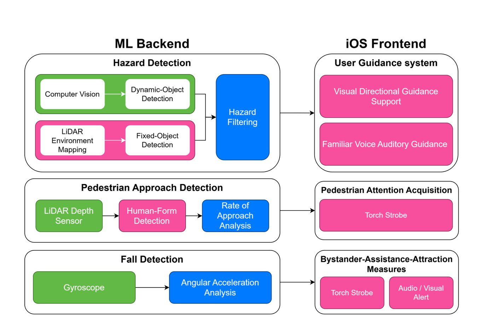
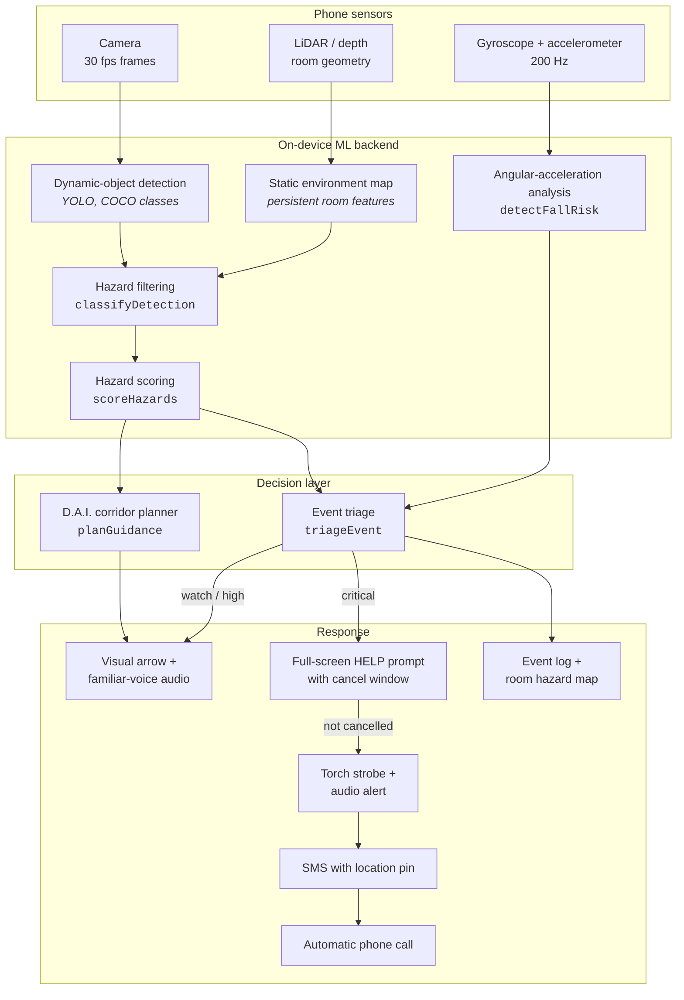

# Architecture

Pathway is a phone clamped to a walking frame. Everything below runs on that phone; the
only thing that leaves it is an alert.

> **Reconstruction status.** The Python detector in [`vision/`](../vision/) is original
> hackathon code. The JavaScript engine in [`src/pathwayEngine.js`](../src/pathwayEngine.js)
> is a reconstruction of the decision logic that sat on top of it. See
> [RECONSTRUCTION_NOTES.md](./RECONSTRUCTION_NOTES.md).

---

## The design from the pitch deck

The technical architecture slide split the system into an ML backend and an iOS frontend,
with three sensing branches:



Two of those three branches are implemented in this repository. Pedestrian approach
detection — the outdoor "game of chicken" branch — is designed but not built; it needed
LiDAR depth streaming that never got written.

---

## Data flow



---

## 1. Camera model

Everything downstream depends on knowing where the camera is. Pathway assumes a phone
clamped to the crossbar of a standard frame:

| Parameter | Value | Why |
|---|---|---|
| `heightMeters` | 0.92 | crossbar height of an NHS walking frame |
| `pitchDegrees` | 20 | angled down so the near floor is in view |
| `focalX` / `focalY` | 0.714 / 0.952 | ≈70° horizontal field of view, normalised to frame width/height |

`projectPoint()` implements a standard pinhole projection with that pitch applied:

```
relativeHeight = y − cameraHeight
depth          = −relativeHeight·sin θ + z·cos θ
vertical       =  relativeHeight·cos θ + z·sin θ

screenX = 0.5 + focalX · x / depth
screenY = 0.5 − focalY · vertical / depth
```

Frame coordinates run `(0,0)` top-left to `(1,1)` bottom-right, matching OpenCV's
convention in the original detector.

A real deployment reads intrinsics from AVFoundation and the mount angle from the phone's
own attitude, rather than hard-coding them.

## 2. Hazard filtering

`classifyDetection()` is a port of `isHazard()` from
[`vision/hazard_detector.py`](../vision/hazard_detector.py). Four conditions, all of which
must hold:

| Check | Rule | Rationale |
|---|---|---|
| `nearFloor` | `max(y1,y2) > 0.65` | object touches the floor close to the walker |
| `notOverhead` | `min(y1,y2) > 0.15` | not a tall object you walk past |
| `classAllowed` | class ∉ `{person, bed, suitcase, couch}` | things you go around, not over |
| `confident` | `confidence > 0.5` | detector's own gate |

The rule is expressed in **frame position**, not metres. That is not laziness — it is what
makes it cheap enough to run every frame on an old phone with no depth sensor. With the
camera model above, the 0.65 threshold corresponds to floor contact within roughly 1.6 m.

Fixed hazards sourced from the room map (`source: "static"`) bypass the COCO ignore list,
because they are geometry, not classifications. That is how a curled rug lip — which no
COCO class covers — gets flagged at all.

The engine reports *every* failed check, not just the first, so the demo can explain why a
mug on a worktop was filtered out rather than just dropping it.

## 3. Hazard scoring

Admitted hazards are scored on four factors:

| Factor | Weight | Definition |
|---|---|---|
| Proximity | 0.36 | `(3 m − distance) / 3 m` |
| Path alignment | 0.26 | `1 − |lateral| / 0.45 m` — how squarely it sits in the walking corridor |
| Class severity | 0.28 | lookup table, `TRIP_SEVERITY` |
| Confidence | 0.10 | ramped from the 0.5 gate to 0.95 |

The **scene** score is deliberately not a mean:

```
score = dominant + (1 − dominant) · meanOfRest · 0.55
```

One severe hazard should not be diluted by a tidy background, but a cluttered floor should
still read as worse than a single obstacle. A mean does neither.

## 4. Fall detection

Six signals, each normalised between a "quiet" floor and an "unambiguous" ceiling:

| Signal | Weight | Quiet → certain |
|---|---|---|
| Angular acceleration | **0.28** | 250 → 1900 °/s² |
| Impact | 0.22 | 1.3 → 3.2 g |
| Angular velocity | 0.16 | 90 → 400 °/s |
| Free-fall dip | 0.14 | 0.75 → 0.30 g |
| Orientation change | 0.10 | 15° → 75° |
| Post-event inactivity | 0.10 | 1.5 → 6 s |

Angular acceleration carries the most weight because the deck describes Pathway's approach
as "angular acceleration driven": a frame tipping about its front legs rotates in a way
that ordinary walking, kerb bumps and hand-offs do not. The weights sum to 1, so the score
is directly interpretable as a fraction of maximum evidence.

Stages: `stable` < 0.22 ≤ `instability` < 0.5 ≤ `fall-suspected` < 0.8 ≤ `fall-confirmed`.

This is a threshold-and-weight detector, not a learned classifier. That was a deliberate
choice — see [TECHNICAL_DECISIONS.md](./TECHNICAL_DECISIONS.md).

## 5. D.A.I. navigation

`planGuidance()` sweeps outward from dead-ahead in 5 cm steps and returns the smallest
lateral correction that fits a 0.6 m walker footprint past every standing obstacle, with a
0.15 m buffer.

Hazards under 8 cm tall — rug lips, door thresholds — are handled separately. You do not
steer a walking frame around a 4 cm sill; you slow down and lift the frame over it, which
is what a physiotherapist would advise. So they produce a `stepOver` instruction appended
to whatever lateral correction the standing obstacles require.

If no corridor fits, the planner returns `stop` rather than inventing a route.

> **On the acronym:** the deck uses "D.A.I." throughout without ever expanding it. This
> reconstruction models it as the layer that fuses **D**ynamic detections **A**nd the
> **I**ndoor static map into one corridor decision. That reading is an inference, not
> something recovered from the original material.

## 6. Triage and escalation

```
combined = 0.62 · fallRisk + 0.38 · hazardScore
```

| Level | Condition | Response |
|---|---|---|
| `critical` | fall risk ≥ 0.80 | HELP prompt → strobe → SMS → call |
| `high` | combined ≥ 0.60, or fall ≥ 0.50, or hazard ≥ 0.70 | guide user, pin to map, notify caregiver |
| `watch` | combined ≥ 0.30 | guide user, pin to map, weekly digest |
| `stable` | otherwise | log passively |

A fall is critical on motion evidence alone — the camera cannot veto the gyroscope. The
scene score only moves the *confidence*, and the ranked hazard queue tells the caregiver
what the person probably tripped over.

The escalation ladder always opens with a cancel window on the device. Nothing is sent for
15 seconds, and "Crisis averted" stops it. That came straight out of the interviews: the
fastest way to get an alarm ignored is to make it cry wolf.

---

## Module map

| File | Contents |
|---|---|
| `src/pathwayEngine.js` | camera model, hazard filter, scoring, fall detection, guidance, triage. Pure functions, no DOM. |
| `src/app.js` | demo controller, canvas renderer, escalation playback, caregiver dashboard. |
| `data/sampleEvents.js` | three world-space scenarios. |
| `vision/hazard_detector.py` | **original** on-device YOLO detector. |
| `test/hazardEngine.test.js` | 27 behavioural tests over the engine. |

The engine has no dependencies and no side effects, so the browser demo and the test suite
exercise exactly the same code path through `runPathway()`.
