
<a href="HACKATHON_STORY.md">English</a> | <strong>日本語</strong>

# オックスフォードでの36時間：Pathwayの開発ストーリー

Oxford Venture 2026 Hackathonで出会った私たちは、36時間でPathwayをつくり、**参加者115人の大会で優勝**しました。その時間をどのように過ごしたかを、ここに残しています。

ピッチに入らなかった出来事も含めて、ストーリーと写真を一緒に残したいと思いました。ソフトウェアと技術の詳細は[構成](./ARCHITECTURE.md)、[技術上の判断](./TECHNICAL_DECISIONS.md)、[再構築メモ](./RECONSTRUCTION_NOTES.md)にあります。

[ブラウザーデモを試す](https://jsmitty78.github.io/Pathway-Oxford1stPlaceHackathon/) · [日本語の起動ガイド](../README.ja.md)

## J-StarXで経験したオックスフォード

**日本の大学生を対象とするJ-StarX起業家育成プログラム**でオックスフォードに来ました。特に覚えているのは、会ったばかりのチームと、借りた3Dプリンターを抱えて午前3時ごろの街を歩いたことです。誰も寝ておらず、まだスマートフォン用のクリップを設計し、試作機を動かす必要がありました。

このチームと働けて本当に良かったです。得意分野は違い、分からないことも多く、時間もほとんどありませんでしたが、お互いを助けながら進めました。滞在中には友人もたくさんできました。道具を貸してくれたり、途中で手を貸してくれたりした人たちがいたからこそ、今でも大切な経験として覚えています。

— **Jake Smith**

## 会場で初めて組んだチーム

Caleb Byrne、Antony He、Aiyush Guptaとはハッカソンで出会いました。それまで一緒に働いたことはなく、共通のリポジトリも、決まったアイデアもありませんでした。チームを組んでから最初の数時間は、どの課題に取り組むか話し合いました。自分たちが関心を持ち、36時間で実際に見せられるものを選ぶ必要がありました。

ユーザー調査、ソフトウェア設計とコンピュータービジョン、CADと市場分析、プロダクトとピッチ。それぞれの力を合わせることで、並行して作業を進められました。ソフトウェアや実機をつくる一方で、人に話を聞き、伝え方も考えました。その別々の作業を、何度も一つにまとめていきました。

<table>
<tr>
<td width="50%">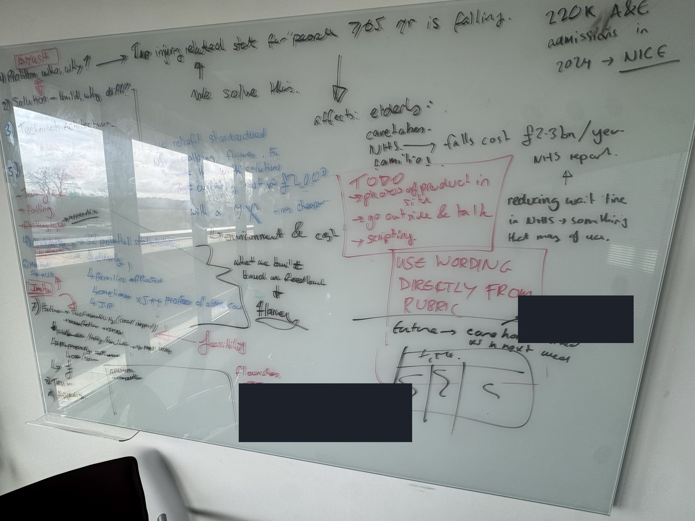</td>
<td width="50%">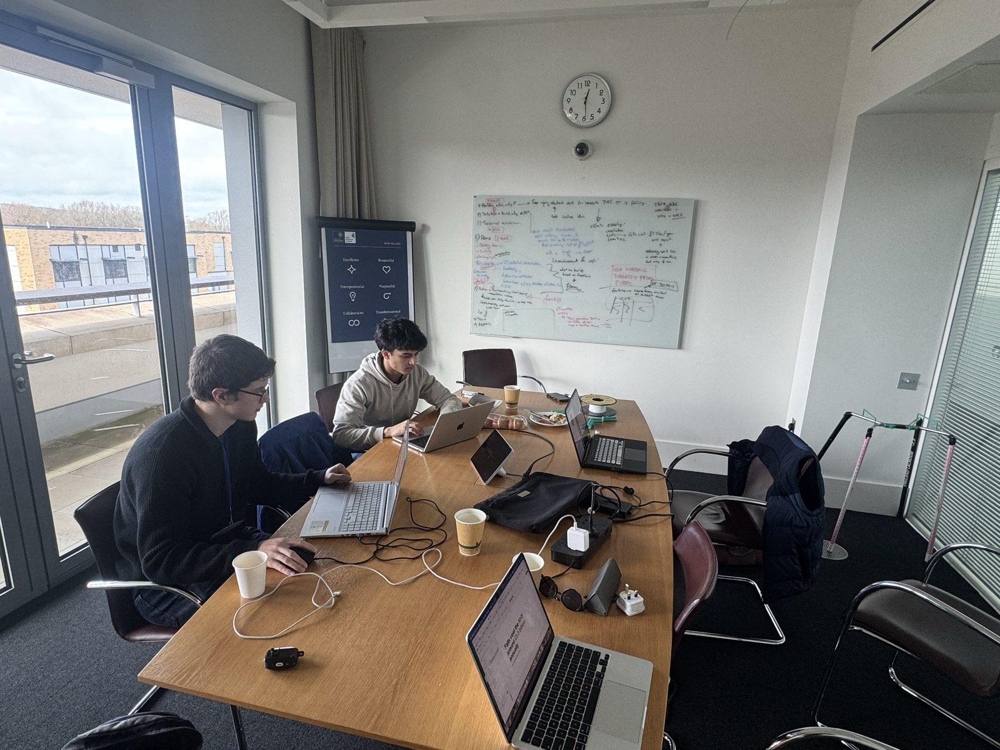</td>
</tr>
<tr>
<td><b>課題を整理する。</b> 発表の構成をホワイトボードで整理しました。2か所を伏せています。詳しくは <a href="../assets/README.md">assets/README.md</a>.</td>
<td><b>夜通しの開発。</b> デックの隣には、フィラメントと印刷したブラケット。</td>
</tr>
</table>

## 取り組む課題を選ぶ

以下の数値と競合比較は、ハッカソンのピッチ準備に使ったものです。当時の考え方を伝えるために残しており、最新の市場調査や臨床評価として示しているものではありません。

最初のホワイトボードで高齢者の転倒について話しました。ピッチには、2024年の英国の転倒による救急受診22万件（NICE）、65歳以上の外傷関連死の主な原因が転倒であること（米国CDC）、NHSに年間約23億ポンドの費用がかかること（NHS England）を掲載しました。

費用の違いも気になりました。NHSは通常の歩行器を無償で提供していますが、比較したスマート歩行器は2,499ドルからで月額料金もかかり、創業から6年経っても出荷されていませんでした。そこで、引き出しに眠っている古いスマートフォンに目を向けました。カメラ、加速度計、ジャイロ、通信、プロセッサーはすでにあります。その機能を、持っている歩行器に追加できないだろうかと考えました。

それがPathwayの出発点です。**すでに持っている歩行器に、引き出しにあるスマートフォンを取り付ける。**

## 建物を出て、話を聞く

つくり込みすぎる前に、人の話を聞く必要がありました。オックスフォードの街に出て、転倒、高齢の家族、歩行器の経験について尋ねました。

**街頭で32人にインタビュー**し、**68%**が過去1年に転倒した高齢者を知っていると答えました。次の3つが開発を変えました。

| 分かったこと | 変えたこと |
|---|---|
| 歩行器の利用者は**屋内**で過ごす時間が長い | 屋内の障害物検出を中心にし、屋外で歩行者を見つけやすくする機能は範囲から外した |
| 介護者は事後報告だけでなく、**その場で関わりたい** | イベントを記録するだけでなく、人への連絡につながる優先度判断を設けた |
| 高齢の利用者には**技術が難しく感じられる**ことがある | 状態表示を一つにし、大きなボタンと、取り消しも同じくらい目立つ全画面の確認を用意した |

**介護施設4か所**にも連絡し、**2か所が後日のテストやデモに関心**を示してくれました。**高齢者ケアの専門家2人**からも関心をいただきました。励みになりましたが、その時点では関心を示していただいた段階です。正式な提携や試験の約束まで成立したわけではなく、イベントでの成果を伝える際には区別しています。

<table>
<tr>
<td width="50%">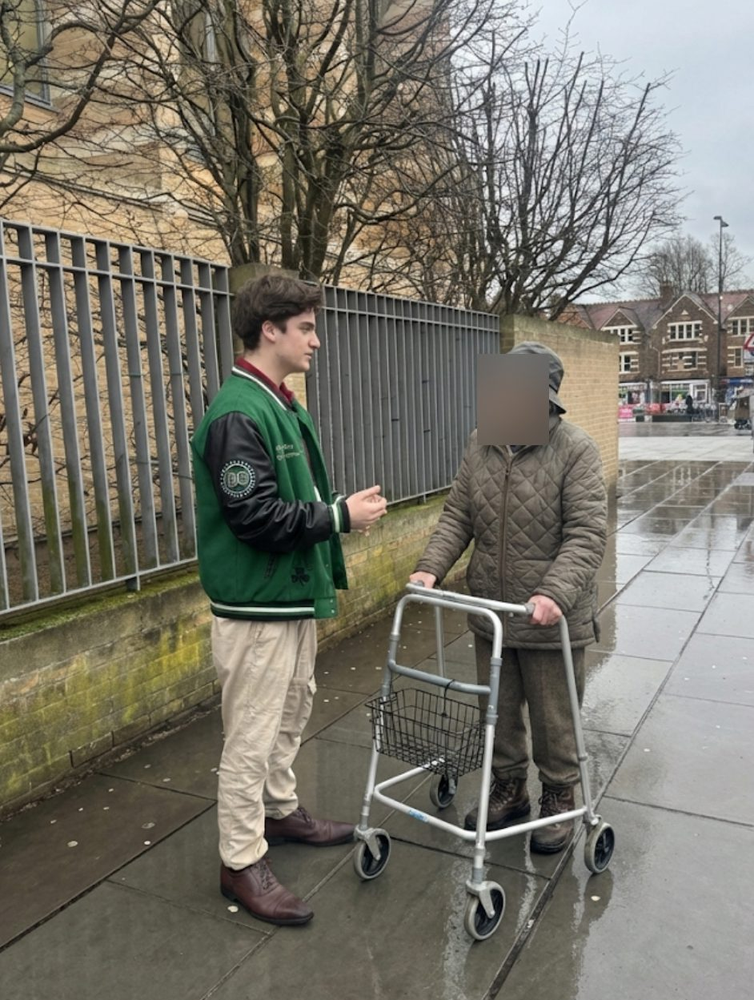</td>
<td width="50%">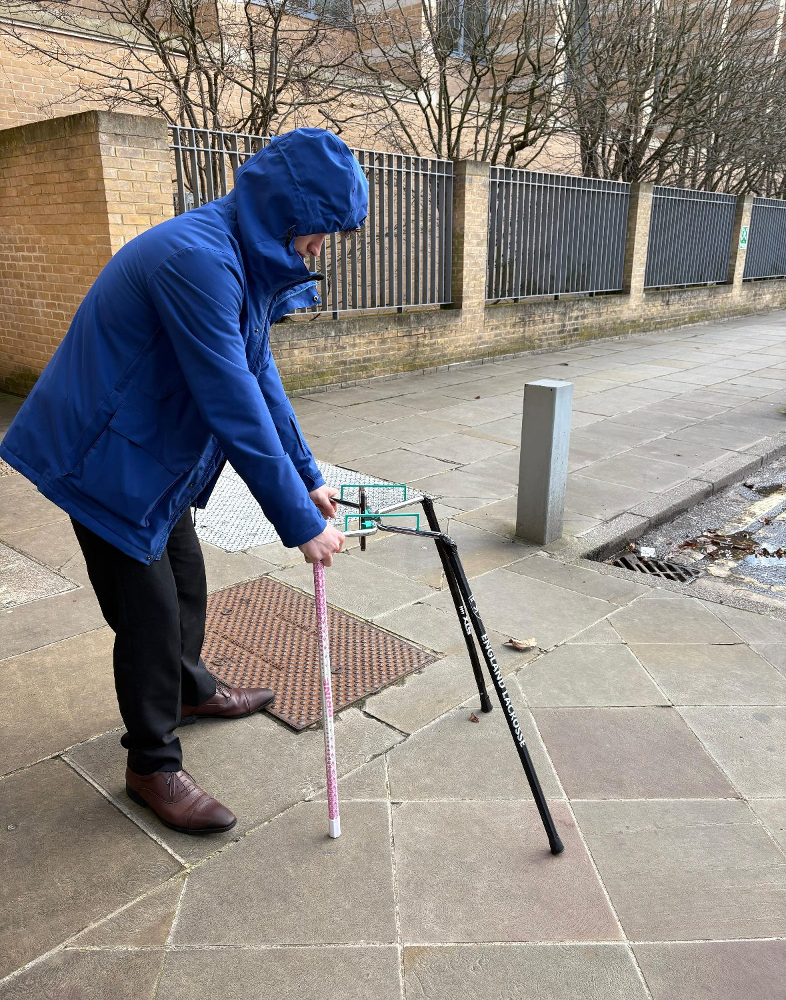</td>
</tr>
<tr>
<td><b>オックスフォードでの聞き取り。</b> 街頭で32人に話を聞きました。プライバシーのため、相手の顔は隠しています。</td>
<td><b>屋外でのテスト。</b> スマートフォンを付けた即席のフレームを、実際の舗道で動かしました。</td>
</tr>
</table>

## 午前2時ごろ：まだ歩行器がない

この時点でも、**歩行器がない**という、とても現実的な問題が残っていました。

思い付く限りの知り合いや介護施設に電話し、借りられないか尋ねました。何度も探しましたが、デモに間に合うものは見つかりません。スマートフォンを取り付けて試すための土台が必要でした。

**午前2時ごろ**、友人の友人のアパートへ行きました。古いラクロスのスティックを持っていて、貸してくれたのです。それをフレームの骨組みにし、テープと一晩でつくれる部品で組み立てました。

人の体を支える歩行補助具ではなく、デモ用の装置でした。それでも、スマートフォンを固定し、統合の問題を考え、アイデアを見せるための実物ができました。

## 午前3時ごろ：プリンターを持って街を歩く

別の友人は3Dプリンターを貸してくれました。**午前3時ごろ**、まだ眠っていない私たちは、それを持ってオックスフォードの街を歩いていました。

あのとき、人がこんなに快く助けてくれたことを今も思い出します。友人の友人がラクロスのスティックを貸してくれ、今度は真夜中に別の友人がプリンターを丸ごと貸してくれました。オックスフォードのそうした文化に驚きました。知り合いをつくり、相談し、みんなで助け合うことは、滞在の中でも特に良かった経験です。

戻ってからは、残りの夜を使ってスマートフォンのクリップとマウントを設計し、部品を印刷してフレームに取り付け、ソフトウェアとハードウェアを一緒に調整しました。私は調査とピッチに加え、実機統合、テスト、デモ前の不具合対応を担当しました。

## 一晩中、試して直す

その後もスマートフォンを固定し、フレームを障害物へ近づけ、何を検出して何を除外するか確認しました。フレームを倒して、転倒の判定が作動するかも試しました。調整しては、もう一度試す。残り時間が少ない中で、実物の配置とソフトウェアを同時に見直す作業でした。

<table>
<tr>
<td width="50%">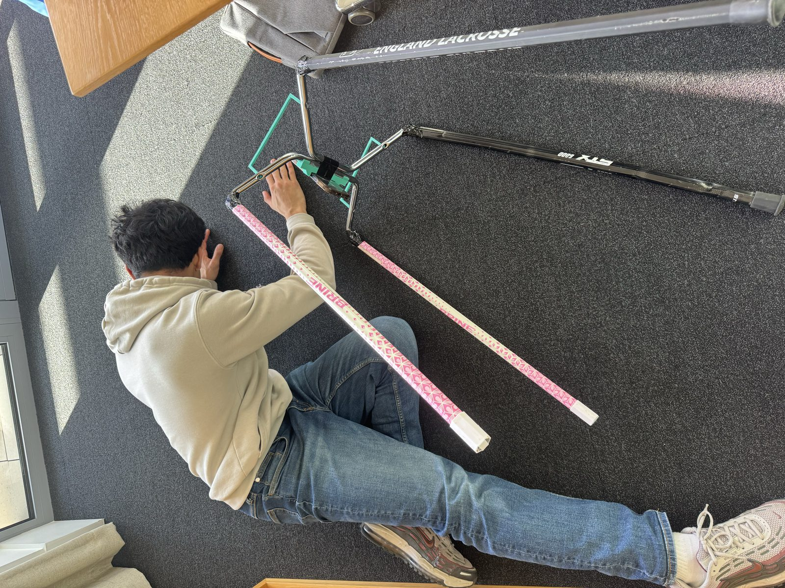</td>
<td width="50%">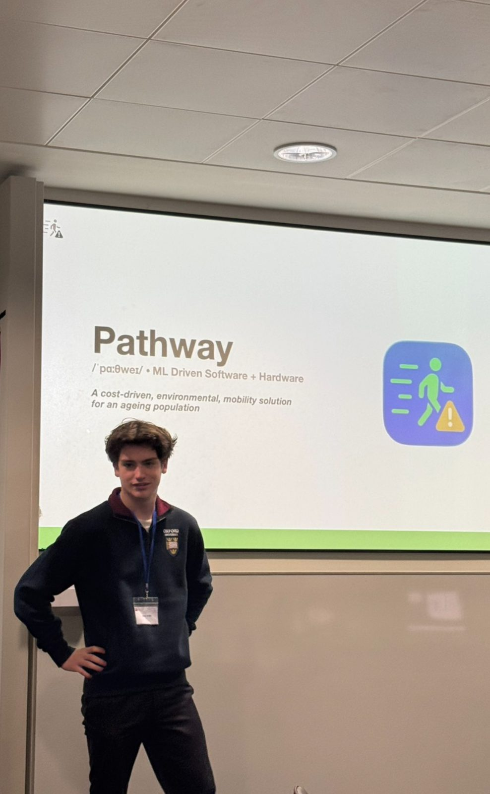</td>
</tr>
<tr>
<td><b>転倒の模擬テスト。</b> フレームと印刷した部品を使い、制御しながら繰り返し倒して確認しました。</td>
<td><b>審査員への発表。</b> チーム結成から36時間後の最終ピッチ。</td>
</tr>
</table>

## 当時の映像に残っているもの

当時の試作が動く様子を示す4本の録画が残っています。元のiOSソースが手元にない今、録画を残しておいて良かったと思います。[`assets/videos/`](../assets/videos)に保存し、[README](../README.md#original-hackathon-footage)で紹介しています。

2本はカメラの検出映像です。一方ではテスト用の部屋の物体すべてに枠と名前が付き、もう一方では危険物のルールが適用され、ソファ、マグカップ、テーブルが除外されて、床のぬいぐるみだけに赤い枠が残ります。続けて見ると、物体を認識することと、進路上の危険と判断することの違いが分かります。

残り2本はiOSアプリの画面録画です。操作ボタン、「Rug detected」「Teddy bear detected」の通知、1秒時点のめくれたラグと10秒時点の床の障害物を、画像と時刻付きで記録した履歴が映っています。

履歴は街頭インタビューで聞いた声から生まれました。介護者は何が起きたかを知りたいと話していたため、危険物の検出とともに画像と時刻を残しました。36時間の中で、聞いたことを画面に反映した一例です。

ピッチ全体の録画もありますが、投影スライドに実際の電話番号、個人名、介護施設名が含まれるため、**公開していません**。詳しくは[画像・映像の説明](../assets/README.md)にまとめています。

## Saïd Business Schoolの近くでテスト

**オックスフォード駅に近いSaïd Business Schoolの周辺**に試作機を持ち出し、人にデモを試してもらいました。自分たちでも、スマートフォンの固定、カメラの向き、部品同士の動作を確認しました。

非公式な試作デモと技術確認です。ピッチの準備には役立ちましたが、人が歩行器を使う際に安全に支援できることを確立したものではありません。

*オックスフォード駅に近いSaïd Business Schoolの周辺で試したときの様子。*

## 審査員の前での実演

最終発表の最後に、一晩かけてつくったものを審査員に見せました。準備して試してきた装置を、会場の前で動かす瞬間でした。

**審査員の前で試作機を倒して転倒を模擬**しました。デモには段階的な連絡の流れを含め、**会場にあるチームの電話に実際の着信が届きました。**

センサーのイベント→検出→優先度判断→連絡というアイデアを、電話が鳴ることで示せました。目の前の模擬転倒と着信を同時に見聞きできたのです。ただ、残っている記録だけではすべての連絡段階が自動だったか確認できないため、全工程を自動化できたとは述べていません。

このデモには、次の2点の制約があります。

- **ハッカソンの試作**であり、臨床検証済みの安全システムではありません。転倒のしきい値は技術上の判断で決めたもので、記録した転倒データから学習したものではありません。
- 連絡先はチーム自身の電話を使いました。**このリポジトリのブラウザーデモでは連絡を模擬し、SMS・通話サービスには接続していません。** 実際の電話番号や住所も含めていません。

## 結果

🏆 **Oxford Venture 2026 Hackathon 優勝**。参加者115人の大会で、初対面の4人が一緒に座ってから36時間後の結果でした。

Saïd Business SchoolのOxford Saïd Entrepreneurship Centreから受賞が発表され、1,500ポンドの賞金とスポンサーのクレジットをいただきました。

<table>
<tr>
<td width="55%">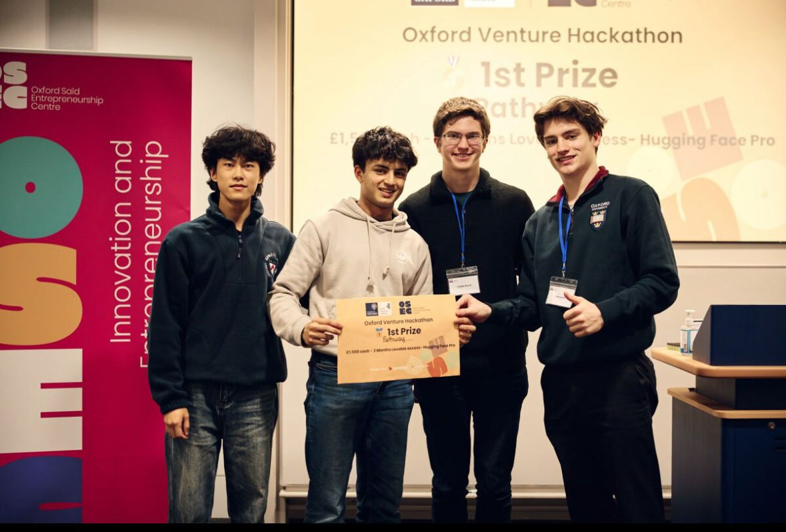</td>
<td width="45%">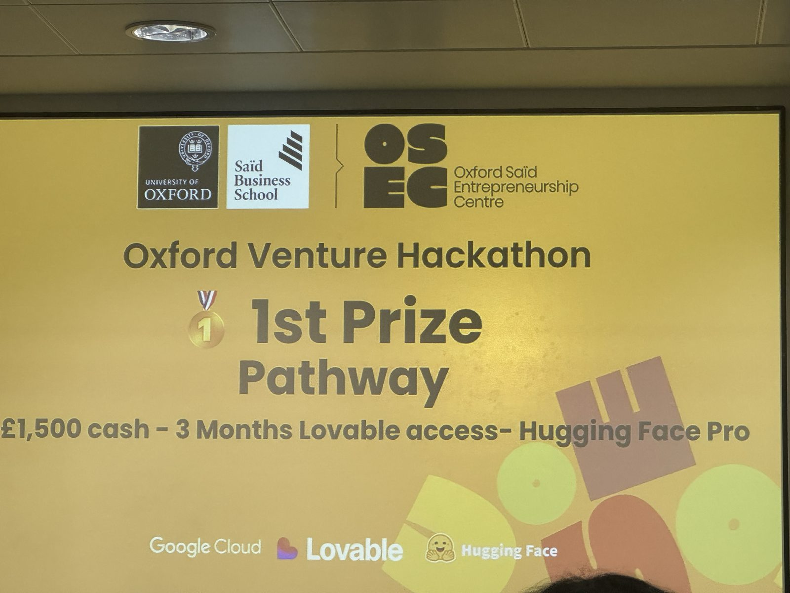</td>
</tr>
<tr>
<td><b>参加者115人の大会で優勝したチーム。</b></td>
<td><b>画面に映った結果</b> — Oxford Venture 2026 Hackathon。</td>
</tr>
</table>

## ハッカソンの外でのオックスフォード

ピッチと優勝の後は、**Keble Collegeの舞踏会**でお祝いし、その後はカレッジのバーでも時間を過ごしました。集中して働いた後の思い出深い締めくくりであり、新しい友人とカレッジの文化を知る機会にもなりました。

J-StarXではオックスフォードの友人がたくさんでき、カレッジの文化を知る時間も楽しみました。Caleb、Antony、Aiyushとの仕事は刺激になり、困ったときに周囲の人が助けてくれたことも印象に残っています。優勝はうれしかったですが、出会った人、夜中の作業、その後に一緒に過ごした時間も残しておきたいと思いました。

<table>
<tr>
<td width="50%">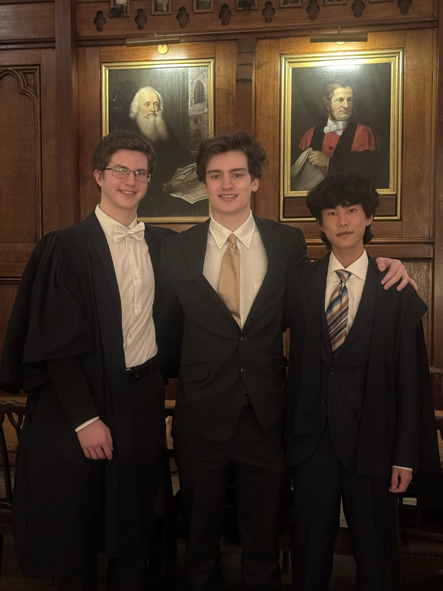</td>
<td width="50%">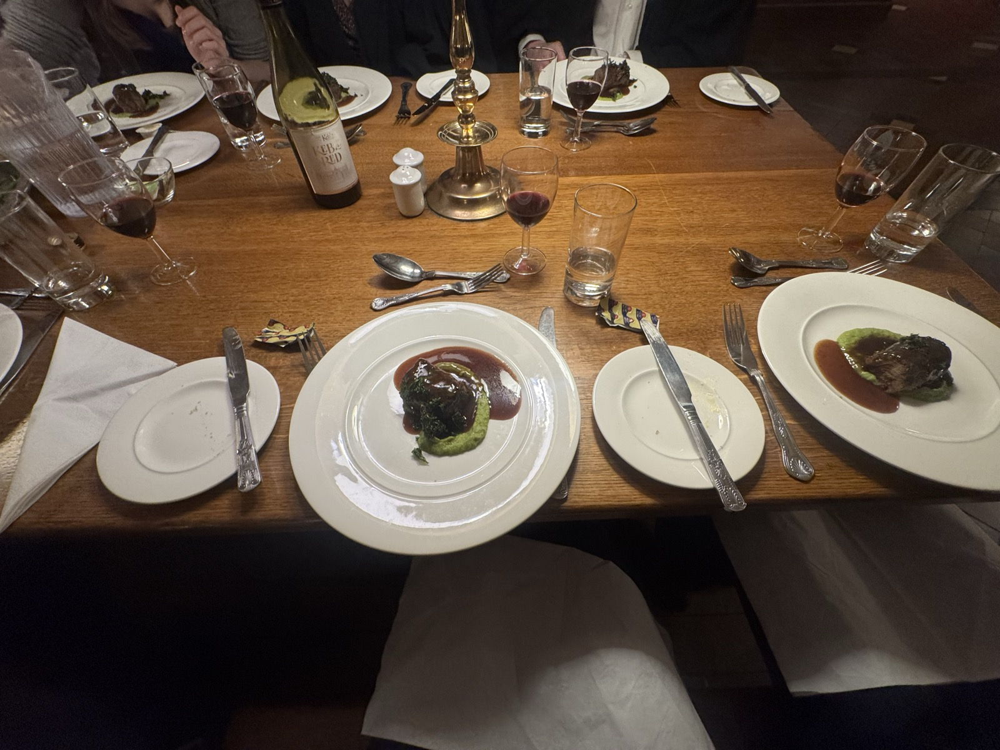</td>
</tr>
<tr>
<td>新しい友人と、オックスフォードのカレッジ生活。</td>
<td>滞在中のカレッジでの夜。</td>
</tr>
</table>

*滞在中の友人やカレッジ生活の写真です。夜通し開発した場面の写真とは区別しています。*

## この経験で学んだこと

**人に話を聞いたことで、つくるものが変わりました。** 午後の時間を使って街で32人に聞き取りをしました。屋内で過ごす時間が長いと知り、屋外から屋内の危険へ焦点を変えました。ラグの端、段差、家の中の物を優先する理由がはっきりしました。

**借りられるもの、つくれるものを使う必要がありました。** 歩行器がなければラクロスのスティックを使いました。予算がほとんどないことから、既存のハードウェアの再利用を考え、それがピッチの中心になりました。追加ハードウェア0.24ポンドという数字もその考えから生まれましたが、製品全体の原価ではなく試作上の見積もりです。

**実演が具体的な目標になりました。** 転倒の可能性が起きてから電話が鳴るまでを見せたかったため、発表前にどの部分をつなげるか決められました。検出の枠だけでなく、情報が人に届く流れも重要でした。

**数字の出所を明確にする必要がありました。** しきい値、重み、深刻度の値は、実測結果に見えてしまうことがあります。多くは技術上の判断でした。このリポジトリでは、前提と測定を区別することも、コードの説明と同じくらい大切にしています。[再構築メモ](./RECONSTRUCTION_NOTES.md)を参照できます。

**次は機材の確保と休息の時間をもっと取りたいです。** 午前3時にプリンターを持って歩いたことは良い思い出ですが、作業が大量に残っていたために眠れていませんでした。機材を早く確保できれば、テストと睡眠の時間を増やせたと思います。

## 当時の成果と、後から再構築した部分

当時何をつくり、後から何を追加したかを、見てくださる方に分かるようにしています。残っているもの、つくり直したもの、今も手元にないものは以下のとおりです。

**36時間の中でつくった当時のもの：** 残存する危険物検出器[`vision/hazard_detector.py`](../vision/hazard_detector.py)、35枚のピッチデックとデモ映像、構成図、実機と3Dプリントしたマウント、実際の電話着信の実演、32人の街頭インタビューと介護施設への連絡、このページの写真、[`assets/videos/`](../assets/videos)の動画。

**リポジトリ用に後から再構築したもの：** ブラウザー画面、[`src/pathwayEngine.js`](../src/pathwayEngine.js)のJavaScriptエンジン、カメラの投影モデル、危険度と優先度のモデル、[`data/sampleEvents.js`](../data/sampleEvents.js)の合成運動シナリオ、模擬の介護者画面、自動テスト27件、この技術資料。

**まだ手元にない当時のもの：** iOSアプリの**ソース**（SwiftUI、RoomPlan、CoreMotion）、センサーの記録、SMS・音声連絡の実装、Core ML配備コード、臨床検証済みの転倒しきい値。映像で動作を見ることはできますが、映像から元のソースを取り戻すことはできません。

---

*Pathwayはハッカソンの試作とポートフォリオです。医療機器でも臨床検証済みのシステムでもなく、転倒の危険がある人の安全をこれに依存させることはできません。*

## 初期のプロダクトスケッチ

*初期のスケッチには、完成した機能だけでなく構想段階の案も含まれています。*

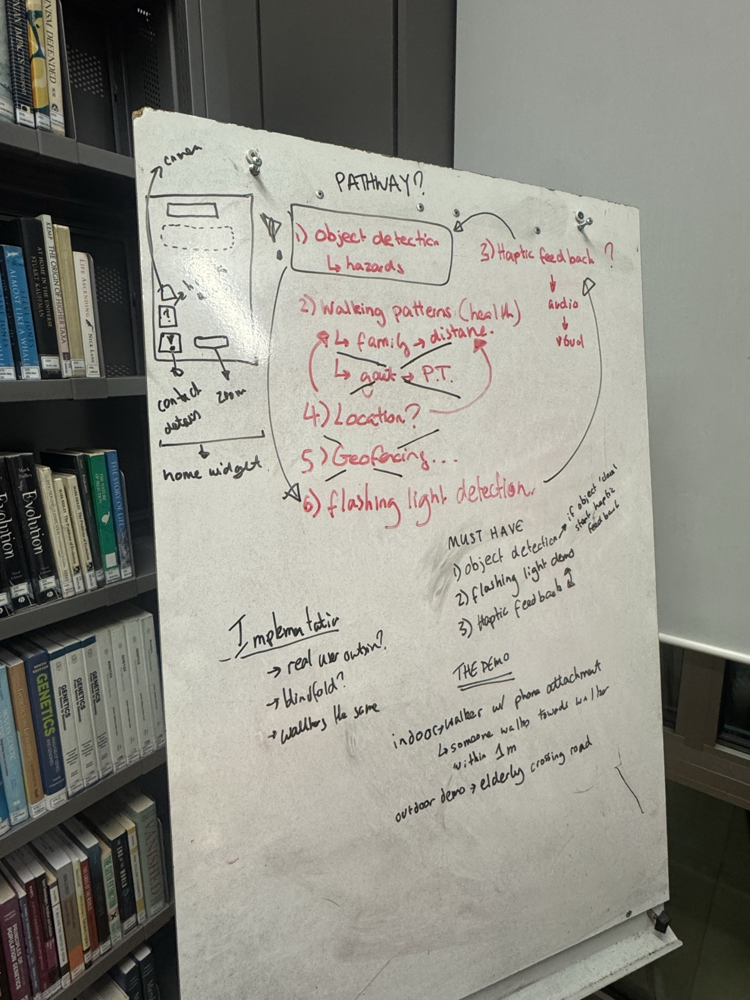
