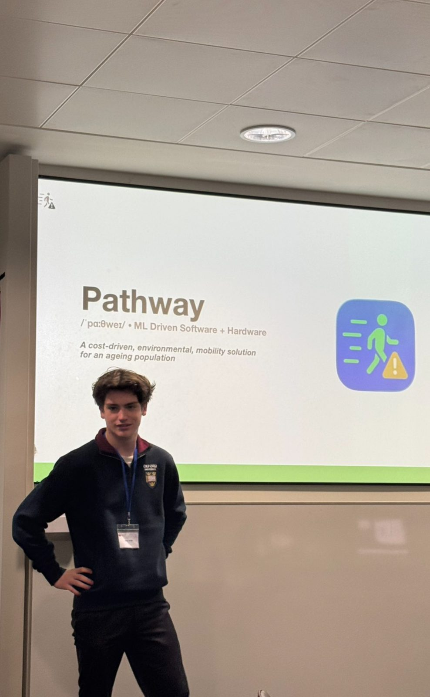

# The 36-hour build: Pathway in Oxford

How Pathway went from four strangers in a room to **1st place in a field of 115 participants**
at the Oxford Venture 2026 Hackathon.

This is the human record of the build. The engineering record lives in
[ARCHITECTURE.md](./ARCHITECTURE.md), [TECHNICAL_DECISIONS.md](./TECHNICAL_DECISIONS.md)
and [RECONSTRUCTION_NOTES.md](./RECONSTRUCTION_NOTES.md).

---

## My Oxford experience through J-StarX

I came to Oxford through the **J-StarX entrepreneurship program for Japanese college students**.
I expected to learn about entrepreneurship; I did not expect to find myself carrying a borrowed
3D printer through Oxford at about three in the morning with a team I had just met.

This is the full account of how we built Pathway, with the original engineering context and
photographs alongside my recollections of the people and the experience. Working with the
team was inspiring, and the friends I made became an important part of my time in Oxford.

— **Jake Smith**

## The team formed at the event

Jake Smith, Caleb Byrne, Antony He and Aiyush Gupta had not met before the hackathon. There
was no pre-existing team, no shared repository, no idea agreed in advance. They met on site,
formed a team there, and spent the first hours doing the thing that decided everything
afterwards: choosing a problem worth 36 hours.

What each of them brought turned out to be complementary rather than overlapping — user
research, software architecture and computer vision, CAD and market analysis, product
framing and the pitch. That is why the project ended up spanning software, hardware and
field research instead of being four people editing the same file.

<table>
<tr>
<td width="50%"></td>
<td width="50%"></td>
</tr>
<tr>
<td><b>Mapping the problem.</b> The whiteboard carries the structure the pitch ended up following. Two areas are redacted — see <a href="../assets/README.md">assets/README.md</a>.</td>
<td><b>Building through the night.</b> Filament spool and printed brackets on the table, next to the deck.</td>
</tr>
</table>

## Choosing the problem

The figures and competitor comparisons below describe the team’s original pitch context;
they are not a current market or clinical assessment.

Falls in older adults were on the whiteboard within the first session, and the numbers held
up: 220,000 UK A&E admissions from falls in 2024 (NICE), falls as the leading cause of
injury-related death in the over-65s (US CDC), roughly £2.3 billion a year to the NHS (NHS
England).

The gap the team went after was not detection technology. It was cost. The NHS gives walking
frames away. The one competing smart walker starts at $2,499 plus a monthly subscription
and, six years after founding, still is not shipping. Meanwhile most households have a
retired smartphone in a drawer that already contains a camera, an accelerometer, a
gyroscope, connectivity and a processor.

Pathway is the join between those two facts: **retrofit the frame the user already has with
the phone that is already in the drawer.**

## Leaving the building

The team did not want to build on desk research alone, so they went out into Oxford and
spoke to people.

**32 interviews with members of the public.** **68%** knew an older adult who had fallen in
the previous year. Three findings changed the build:

| Finding | What changed |
|---|---|
| Most walker users spend their time **indoors** | Indoor hazard detection became the core of the product; the outdoor pedestrian-visibility branch was descoped |
| Caregivers want to be **in the loop**, not informed afterwards | Every event ends in a triage decision that can escalate to a person, not a silent log entry |
| Technology is often **hard for older users** | One status pill, one rail of large buttons, and a full-screen confirmation with an equally prominent way out |

In parallel the team contacted **four care homes**; **two expressed interest in a follow-up
test or a scheduled demonstration**. **Two elderly-care experts** also expressed interest.
None of this was a formal partnership or a committed trial, and it is not described as one
anywhere in this repository.

<table>
<tr>
<td width="50%"></td>
<td width="50%"></td>
</tr>
<tr>
<td><b>Talking to people, not just to search results.</b> 32 interviews around Oxford. The interviewee's face is obscured for privacy.</td>
<td><b>Testing outdoors.</b> The improvised frame, phone mounted, walked over real paving.</td>
</tr>
</table>

## About 2 a.m.: still no walking frame

There was a fairly fundamental problem with our walking-frame prototype: **we did not have a walking frame**.

We called people we knew and contacted care homes, trying to find one we could borrow. Despite all the outreach, we could not get one in time.

At about **2 a.m.**, we went to a friend-of-a-friend's apartment. He had some old lacrosse sticks and agreed to lend them to us. Those sticks became the basis of our improvised frame, held together with tape and the parts we could make overnight.

It was a demonstration rig, not a mobility aid for someone to rely on. But it gave us a physical structure on which to mount the phone, work through integration problems and show the idea.

## About 3 a.m.: a printer on the streets of Oxford

Another friend had a 3D printer we could borrow. By about **3 a.m.**, we were walking through Oxford with it, still without sleep.

That walk captured something I loved about the experience. People we had only recently met were willing to help us make an idea happen. A conversation led to a borrowed piece of equipment; that equipment made the next part of the build possible. I was discovering Oxford through its people as much as through its buildings and colleges.

Back with the team, we spent the rest of the night designing the phone clips and mount, printing parts, fitting them to the frame and working through the software and hardware together. My contribution included physical prototype integration, testing and troubleshooting ahead of the demonstration, alongside research and the pitch.

## Overnight testing

The rest of the night went into the loop that mattered: mount the phone, walk the frame at
hazards, watch what the detector admitted and what it filtered out, tip the frame over,
watch whether the fall logic fired, adjust, repeat.

<table>
<tr>
<td width="50%"></td>
<td width="50%"></td>
</tr>
<tr>
<td><b>Simulated-fall testing.</b> The frame, the printed brackets, and a lot of controlled tipping.</td>
<td><b>Presenting to the judges.</b> The final pitch, 36 hours after the team met.</td>
</tr>
</table>

## What the footage caught

Four recordings from those hours survived, and they are the closest thing left to the
original build actually running. They are in [`assets/videos/`](../assets/videos) and are
laid out in the [README](../README.md#original-hackathon-footage).

Two are camera recordings of the detector: one pass through the test lounge with everything
boxed and labelled, and the same pass with the hazard rule applied, where the couch and the
mugs and the table all drop away and only the soft toy on the floor keeps a red box. Watching
them back to back is the clearest statement of what Pathway actually did.

The other two are screen recordings of the iOS app — the control rail, a "Rug detected"
toast, a "Teddy bear detected" toast, and the incident log listing a warped rug at one second
and a floor obstacle at ten, each with a captured still and a timestamp.

That log is the part worth pausing on. It is the "caregivers want to be in the loop" finding
from the street interviews, turned into a screen, inside 36 hours.

The full pitch was also filmed, and is **not published** — the projected slides carry a real
phone number, a named individual and a named care home. See
[assets/README.md](../assets/README.md) for the detail.

## Testing near Saïd Business School

We took the prototype outside near **Saïd Business School, close to Oxford railway station**, and had people try the demonstration. We also tested it ourselves, checking the phone mount, the camera view and how the parts worked together.

These were informal prototype demonstrations and engineering checks. They helped us prepare for the pitch; they did not establish that the system could safely support someone using a walking frame.

*Outdoor prototype testing near Saïd Business School, as recalled from the event.*

## The live demonstration

The final presentation ended with the demonstration the team had spent the night earning.

They **tipped the prototype over in front of the judges** to simulate a fall. The demonstration included
an escalation workflow and a **real phone call to the team's phone, live in the room.**

The phone call made the intended sensor-event → detection → triage → contact experience
tangible in the room. The surviving records do not establish whether every step was
automated, so this account does not make that claim.

Two honest caveats, which the team also made in the room:

- It was a **hackathon prototype**, not a clinically validated safety system. The fall
  thresholds were engineering judgement, never fitted to recorded falls.
- The escalation ran on the team's own phone and contacts. **This repository's browser demo
  simulates that flow — it is not wired to any live SMS or voice service**, and no real
  number or address appears anywhere in it.

## The result

🏆 **1st Place, Oxford Venture 2026 Hackathon** — 1st place in a field of 115 participants,
36 hours after four strangers sat down together.

The award was announced by the Oxford Saïd Entrepreneurship Centre at Saïd Business School;
the prize was £1,500 alongside sponsor credits.

<table>
<tr>
<td width="55%"></td>
<td width="45%"></td>
</tr>
<tr>
<td><b>The team after winning 1st place in a field of 115 participants.</b></td>
<td><b>The result on screen</b> at the Oxford Venture 2026 Hackathon.</td>
</tr>
</table>

## The Oxford experience beyond the hackathon

After the pitching and the win, we celebrated at a **Keble College ball**, followed by time at the college bar. It was a memorable end to an intense stretch of work, and another chance to experience Oxford's college culture with new friends.

The friendships were a major part of my J-StarX experience. I left with people I wanted to stay in touch with, an appreciation for the community around us, and a clearer sense of how much I enjoy building with a committed team.

<table>
<tr>
<td width="50%"></td>
<td width="50%"></td>
</tr>
<tr>
<td>New friendships and an introduction to Oxford college life.</td>
<td>A college evening during the Oxford stay.</td>
</tr>
</table>

*These personal photographs document the wider Oxford experience. They are not technical evidence for the prototype or a record of the exact overnight timeline.*

## What we learned

**Field research beats desk research, and it is faster than it looks.** Walking into Oxford
and asking 32 people a question took an afternoon and reversed a product decision — indoors,
not outdoors. No amount of reading would have produced that with the same confidence.

**Constraint is a design tool.** No walking frame available meant improvising one, and the
£0.24 hardware figure the deck leads on came from having no budget in the first place. The
cheapness became the pitch rather than an apology inside it.

**Demonstrate the loop, not the screen.** The judges did not need to see a detection
overlay; they needed to see a phone ring. Building toward one end-to-end moment shaped what
was worth finishing and what was worth cutting.

**Write down which numbers are measured.** Almost everything quantitative in the original
build was judgement — thresholds, weights, severities. Recording that honestly at the time
made this reconstruction possible; the alternative would have been a repository full of
numbers nobody could defend. See [RECONSTRUCTION_NOTES.md](./RECONSTRUCTION_NOTES.md).

**Sleep is a real dependency.** The approximately 3:00 a.m. printer walk was fun and it was also the
symptom of a plan with no slack in it.

## Original versus reconstructed

The distinction matters, so it is stated in every document rather than assumed.

**Original — produced during the 36 hours:** the surviving hazard detector
[`vision/hazard_detector.py`](../vision/hazard_detector.py), the 35-slide pitch deck and its
demo footage, the architecture slide, the physical prototype and its 3D-printed mount, the
live phone-call demonstration, the 32 field interviews and the care-home outreach, the
photographs on this page, and the video in [`assets/videos/`](../assets/videos).

**Reconstructed — written afterwards for this repository:** the browser interface, the
JavaScript engine in [`src/pathwayEngine.js`](../src/pathwayEngine.js), the camera
projection model, the hazard scoring and triage models, the synthetic motion scenarios in
[`data/sampleEvents.js`](../data/sampleEvents.js), the mock caregiver dashboard, the 27
automated tests, and this documentation set.

**Still missing, and not reconstructable:** the original iOS app **source** (SwiftUI,
RoomPlan, CoreMotion), the recorded sensor traces, the real SMS and voice integration, the
Core ML deployment code, and any clinically validated fall thresholds. The footage shows the
app running; it does not bring the code back.

---

*Pathway is a hackathon prototype and a portfolio artefact. It is not a medical device, it
has not been clinically validated, and it must not be relied on by anyone at risk of
falling.*

## Early product sketch

*The early sketch includes proposals, not just completed features.*
