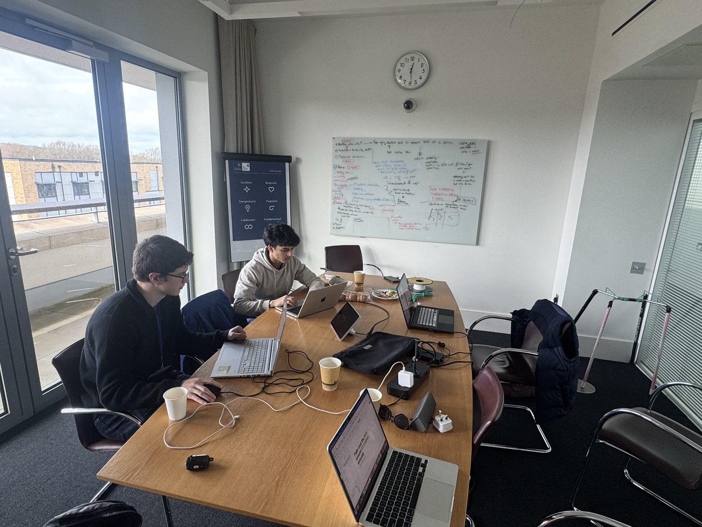
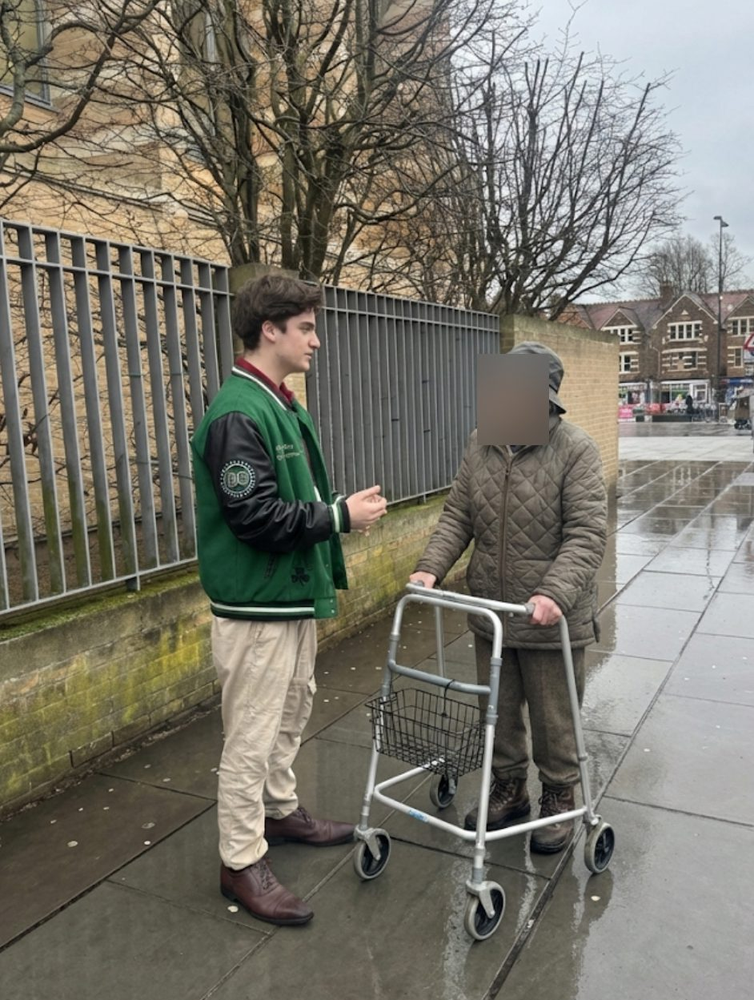
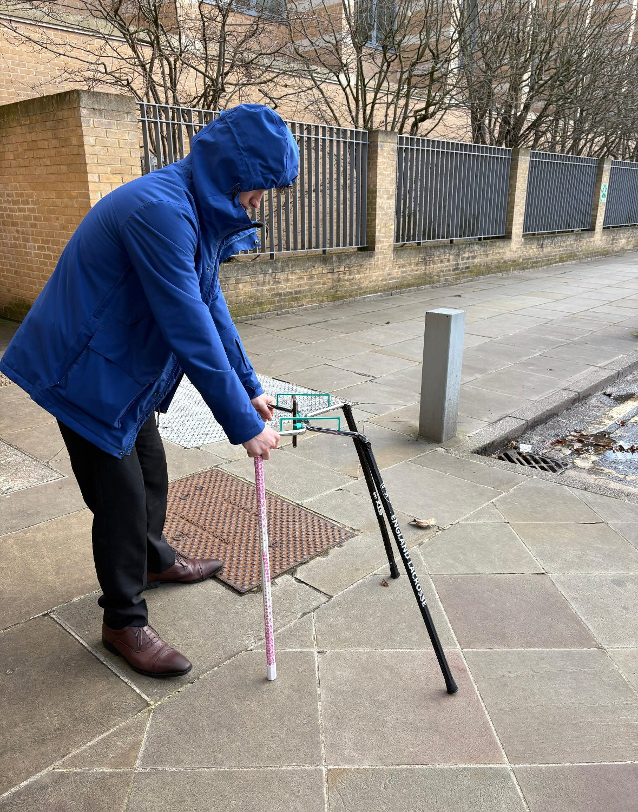
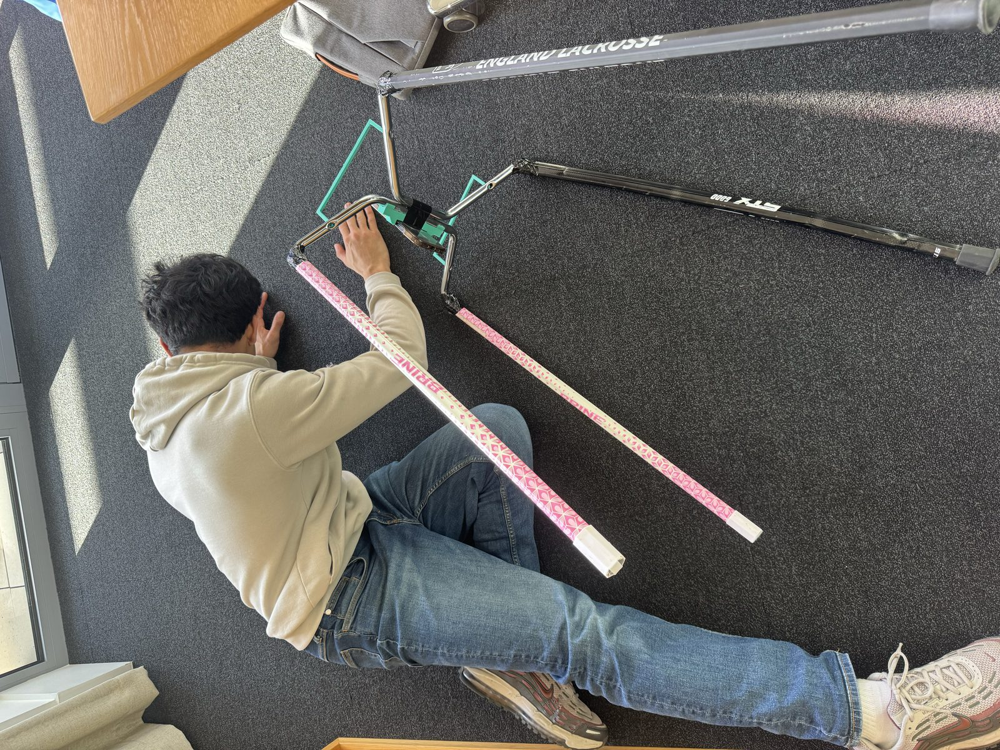
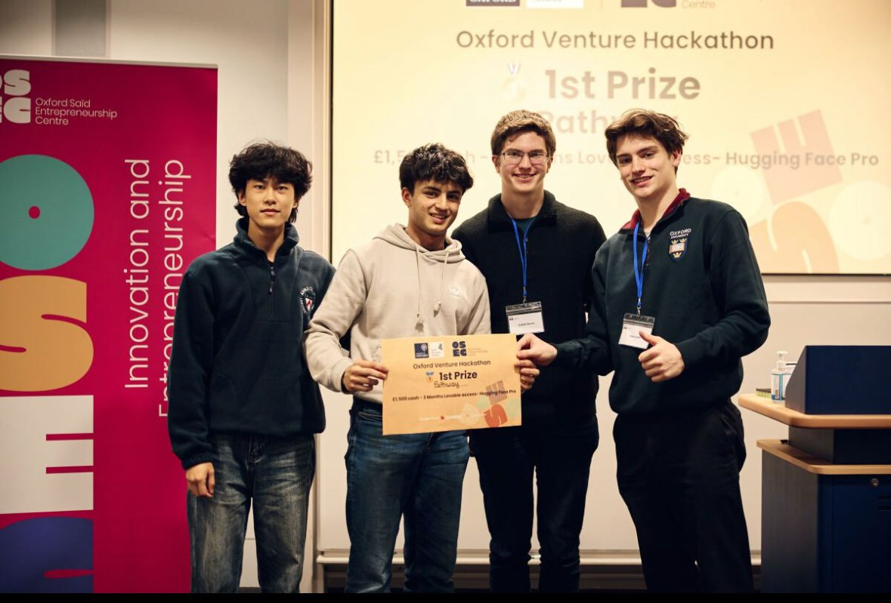
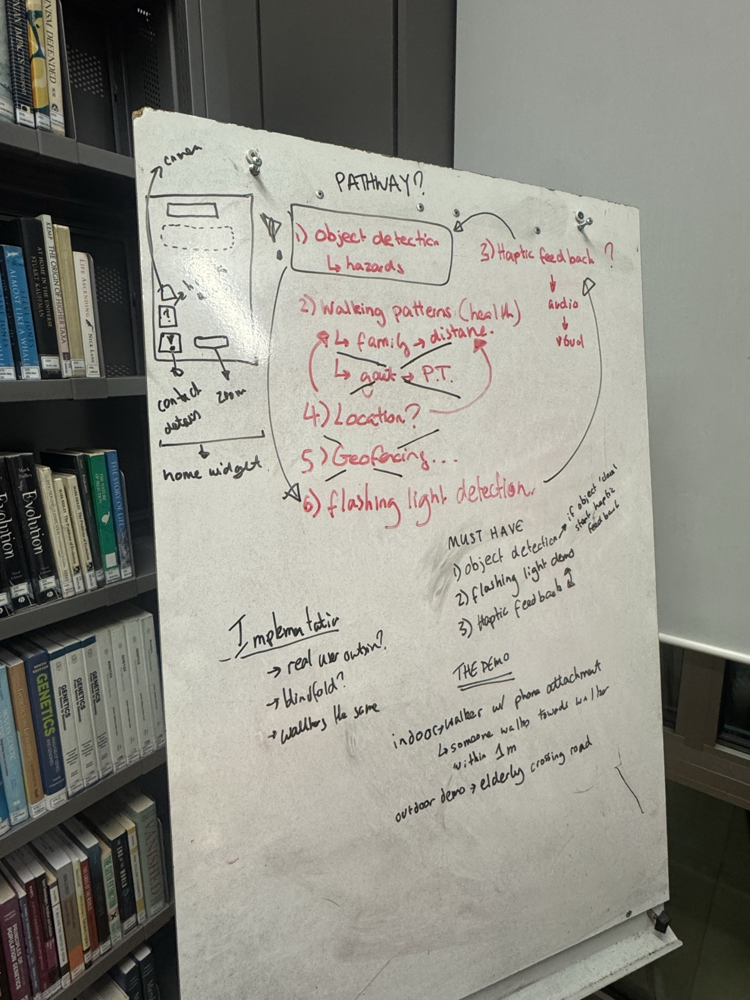

<strong>English</strong> | <a href="HACKATHON_STORY.ja.md">日本語</a>

# The 36-hour build: Pathway in Oxford

We met at the Oxford Venture 2026 Hackathon, built Pathway together in 36 hours, and won
**1st place in a field of 115 participants**. This is how those hours went for us.

I wanted to keep the story and the photos together, including the parts that never made it
into the pitch. For the software and engineering details, see
[ARCHITECTURE.md](./ARCHITECTURE.md), [TECHNICAL_DECISIONS.md](./TECHNICAL_DECISIONS.md)
and [RECONSTRUCTION_NOTES.md](./RECONSTRUCTION_NOTES.md).

---

## My Oxford experience through J-StarX

I came to Oxford through the **J-StarX entrepreneurship program for Japanese college students**.
One of my favourite memories from the program is walking through Oxford at about three in
the morning, carrying a borrowed 3D printer with a team I had only just met. None of us had
slept, and we still had phone clips to design and a prototype to get working.

Working with this team was great. We had different skills, plenty to figure out, and very
little time, but everyone kept helping each other move forward. I also made so many good
friends during my time in Oxford. The people who lent us equipment and helped us along the
way are a big part of why I remember the experience so fondly.

— **Jake Smith**

## The team formed at the event

I met Caleb Byrne, Antony He and Aiyush Gupta at the hackathon. We had not worked together
before, and we arrived without a shared repository or an idea already agreed. Once we
formed the team, we spent the first few hours talking through problems we could work on.
We needed to choose something we cared about and could actually demonstrate within 36 hours.

Between us, we could cover user research, software architecture and computer vision, CAD
and market analysis, and the product and pitch. That mix helped us get a lot done at once.
While some of us worked on the software or physical prototype, we could also speak to
people and work out how to explain the idea. We had to keep bringing those pieces together.

<table>
<tr>
<td width="50%"></td>
<td width="50%"></td>
</tr>
<tr>
<td><b>Mapping the problem.</b> The whiteboard carries the structure the pitch ended up following. Two areas are redacted — see <a href="../assets/README.md">assets/README.md</a>.</td>
<td><b>Building through the night.</b> Filament spool and printed brackets on the table, next to the deck.</td>
</tr>
</table>

## Choosing the problem

These are the figures and competitor comparisons we used when preparing our pitch at the
hackathon. I have kept them here to explain our thinking at the time; they are not an
updated market review or a clinical assessment.

We started discussing falls in older adults during our first whiteboard session. The
figures we included in the pitch were: 220,000 UK A&E admissions from falls in 2024 (NICE), falls as the leading cause of
injury-related death in the over-65s (US CDC), roughly £2.3 billion a year to the NHS (NHS
England).

Cost was a big part of our discussion. The NHS supplies walking frames free of charge,
while the smart walker we compared in our pitch started at $2,499 plus a monthly
subscription and had not shipped six years after the company was founded. We kept coming
back to the old phones people have sitting in drawers. Those phones already have a camera,
an accelerometer, a gyroscope, connectivity and a processor. Could we use that hardware
to add useful features to a frame someone already owned?

That became the idea behind Pathway: **retrofit the frame the user already has with
the phone that is already in the drawer.**

## Leaving the building

We needed to hear from people before getting too far into the build. We went out into
Oxford, spoke to members of the public and asked about falls and their experiences with
older relatives and walking frames.

**32 interviews with members of the public.** **68%** knew an older adult who had fallen in
the previous year. Three findings changed the build:

| Finding | What changed |
|---|---|
| Most walker users spend their time **indoors** | Indoor hazard detection became the core of the product; the outdoor pedestrian-visibility branch was descoped |
| Caregivers want to be **in the loop**, not informed afterwards | Every event ends in a triage decision that can escalate to a person, not a silent log entry |
| Technology is often **hard for older users** | One status pill, one rail of large buttons, and a full-screen confirmation with an equally prominent way out |

Alongside those conversations, we contacted **four care homes**; **two expressed interest in a follow-up
test or a scheduled demonstration**. **Two elderly-care experts** also expressed interest.
Those conversations were encouraging, but they were expressions of interest. We had not
agreed a formal partnership or committed anyone to a trial, and I want to keep that clear
when describing what we achieved during the event.

<table>
<tr>
<td width="50%"></td>
<td width="50%"></td>
</tr>
<tr>
<td><b>Our conversations around Oxford.</b> 32 interviews around Oxford. The interviewee's face is obscured for privacy.</td>
<td><b>Testing outdoors.</b> The improvised frame, phone mounted, walked over real paving.</td>
</tr>
</table>

## About 2 a.m.: still no walking frame

By this point, we still had a very practical problem: **we did not have a walking frame**.

We called everyone we could think of and contacted care homes, asking whether anyone had a walking frame we could borrow. We kept trying, but we could not get one in time for the demonstration. We still needed something to mount the phone on and test.

At about **2 a.m.**, we went to a friend-of-a-friend's apartment. He had some old lacrosse sticks and agreed to lend them to us. Those sticks became the basis of our improvised frame, held together with tape and the parts we could make overnight.

It was a demonstration rig, not a mobility aid for someone to rely on. But it gave us a physical structure on which to mount the phone, work through integration problems and show the idea.

## About 3 a.m.: a printer on the streets of Oxford

Another friend had a 3D printer we could borrow. By about **3 a.m.**, we were walking through Oxford with it, still without sleep.

I still think about how willing people were to help us. A friend of a friend had lent us the lacrosse sticks, and now another friend was lending us a whole 3D printer in the middle of the night. I was amazed by that part of Oxford culture. Getting to know people, asking around and seeing everyone help each other was one of the best parts of being there.

Back with the team, we spent the rest of the night designing the phone clips and mount, printing parts, fitting them to the frame and working through the software and hardware together. My contribution included physical prototype integration, testing and troubleshooting ahead of the demonstration, alongside research and the pitch.

## Overnight testing

For the rest of the night, we kept mounting the phone, moving the frame towards hazards
and checking what the detector picked up or filtered out. We also tipped the frame over
to check whether the fall logic fired. Then we adjusted things and tried again. It meant
working through the physical setup and the software together, with very little time left.

<table>
<tr>
<td width="50%"></td>
<td width="50%"></td>
</tr>
<tr>
<td><b>Simulated-fall testing.</b> The frame, the printed brackets, and a lot of controlled tipping.</td>
<td><b>Presenting to the judges.</b> The final pitch, 36 hours after the team met.</td>
</tr>
</table>

## What the footage caught

We still have four recordings from those hours that show the original build running. I am
glad we kept them, especially because we no longer have the original iOS source. They are in [`assets/videos/`](../assets/videos) and are
laid out in the [README](../README.md#original-hackathon-footage).

Two are camera recordings of the detector: one pass through the test lounge with everything
boxed and labelled, and the same pass with the hazard rule applied, where the couch and the
mugs and the table all drop away and only the soft toy on the floor keeps a red box. Watching
them back to back makes it easier to see the difference between recognising an object
and deciding that it might be a hazard in someone’s path.

The other two are screen recordings of the iOS app — the control rail, a "Rug detected"
toast, a "Teddy bear detected" toast, and the incident log listing a warped rug at one second
and a floor obstacle at ten, each with a captured still and a timestamp.

The incident log connected directly to what people had told us in the street interviews.
Caregivers wanted to know what had happened, so the app kept a still and a timestamp
alongside each detected hazard. It was one way we brought those conversations into the
interface during the 36 hours.

The full pitch was also filmed, and is **not published** — the projected slides carry a real
phone number, a named individual and a named care home. See
[assets/README.md](../assets/README.md) for the detail.

## Testing near Saïd Business School

We took the prototype outside near **Saïd Business School, close to Oxford railway station**, and had people try the demonstration. We also tested it ourselves, checking the phone mount, the camera view and how the parts worked together.

These were informal prototype demonstrations and engineering checks. They helped us prepare for the pitch; they did not establish that the system could safely support someone using a walking frame.

*Testing our prototype outside near Saïd Business School, close to Oxford railway station.*

## The live demonstration

At the end of the final presentation, it was time to show the judges what we had been
working on all night. We had tested the setup, and now we needed to demonstrate it in
front of the room.

We **tipped the prototype over in front of the judges** to simulate a fall. The demonstration included
an escalation workflow and a **real phone call to our team’s phone, live in the room.**

The phone ringing let us show the full idea: sensor-event → detection → triage → contact.
Someone in the room could see the simulated fall and hear the call arrive. The records
we still have do not show whether every contact step was automated, so I cannot confirm
that the whole sequence ran automatically.

There are two limits to keep in mind when looking back at that demonstration:

- It was a **hackathon prototype**, not a clinically validated safety system. The fall
  thresholds were engineering judgement, never fitted to recorded falls.
- The escalation used our own team phone and contacts. **This repository's browser demo
  simulates that flow — it is not wired to any live SMS or voice service**, and no real
  number or address appears anywhere in it.

## The result

🏆 **1st Place, Oxford Venture 2026 Hackathon** — 1st place in a field of 115 participants,
36 hours after four strangers sat down together.

The award was announced by the Oxford Saïd Entrepreneurship Centre at Saïd Business School;
the prize was £1,500 alongside sponsor credits.

<table>
<tr>
<td width="55%"></td>
<td width="45%"></td>
</tr>
<tr>
<td><b>The team after winning 1st place in a field of 115 participants.</b></td>
<td><b>The result on screen</b> at the Oxford Venture 2026 Hackathon.</td>
</tr>
</table>

## The Oxford experience beyond the hackathon

After the pitching and the win, we celebrated at a **Keble College ball**, followed by time at the college bar. It was a memorable end to an intense stretch of work, and another chance to experience Oxford's college culture with new friends.

I made so many great Oxford friends during J-StarX, and I really enjoyed getting to know the college culture. Working with Caleb, Antony and Aiyush was inspiring, and so was seeing how people around us helped when we needed something. Winning was exciting, but I also want to remember the people, the late-night work and the time we spent together afterwards.

<table>
<tr>
<td width="50%"></td>
<td width="50%"></td>
</tr>
<tr>
<td>New friendships and an introduction to Oxford college life.</td>
<td>A college evening during the Oxford stay.</td>
</tr>
</table>

*A few photos from my wider stay in Oxford. These are memories of the people and college life during the visit, rather than photos of the overnight build itself.*

## What we learned

**Speaking to people changed what we built.** We spent an afternoon talking to 32 people
around Oxford. Hearing how much time walker users spent indoors made us change our focus
from outdoor use to indoor hazards. Those conversations gave us a much clearer reason
for prioritising the rug edges, thresholds and objects people encounter at home.

**We had to work with what we could borrow or make.** When we could not get a walking
frame, we used lacrosse sticks. Having almost no budget also pushed us towards reusing
hardware, which became central to the pitch. The deck’s £0.24 marginal hardware figure
came out of that approach, although it was a prototype estimate rather than a full product cost.

**The live demonstration gave us something concrete to work towards.** We wanted to show
what happened after a possible fall, all the way through to a phone ringing. That helped
us decide which parts needed to work together before the pitch. The detection overlay
mattered, but so did showing how the information could reach another person.

**We needed to be clear about where the numbers came from.** The thresholds, weights and
severity values in a build like this are easy to mistake for measured results. Most were
engineering judgements. When putting this repository together, keeping those assumptions
separate from measurements mattered just as much as documenting how the code worked. See [RECONSTRUCTION_NOTES.md](./RECONSTRUCTION_NOTES.md).

**Next time, I would leave more time for equipment and rest.** Walking through Oxford with
a printer at about 3 a.m. is a great memory, but we were still awake because we had so
much left to do. Getting hold of the hardware earlier would have given us more time for
testing and a better chance of getting some sleep.

## Original versus reconstructed

I want someone looking through this project to know what we built at the event and what
was added afterwards. Here is what remains from the hackathon, what was rebuilt for this
repository, and what we still do not have.

**Original — produced during the 36 hours:** the surviving hazard detector
[`vision/hazard_detector.py`](../vision/hazard_detector.py), the 35-slide pitch deck and its
demo footage, the architecture slide, the physical prototype and its 3D-printed mount, the
live phone-call demonstration, the 32 field interviews and the care-home outreach, the
photographs on this page, and the video in [`assets/videos/`](../assets/videos).

**Reconstructed — written afterwards for this repository:** the browser interface, the
JavaScript engine in [`src/pathwayEngine.js`](../src/pathwayEngine.js), the camera
projection model, the hazard scoring and triage models, the synthetic motion scenarios in
[`data/sampleEvents.js`](../data/sampleEvents.js), the mock caregiver dashboard, the 27
automated tests, and this documentation set.

**Original material we still do not have:** the original iOS app **source** (SwiftUI,
RoomPlan, CoreMotion), the recorded sensor traces, the real SMS and voice integration, the
Core ML deployment code, and any clinically validated fall thresholds. The footage lets us see the
app running, but we cannot recover its source code from those recordings.

---

*Pathway is a hackathon prototype and a portfolio artefact. It is not a medical device, it
has not been clinically validated, and it must not be relied on by anyone at risk of
falling.*

## Early product sketch

*The early sketch includes proposals, not just completed features.*
