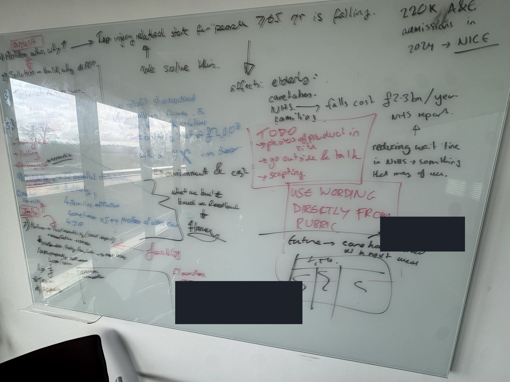
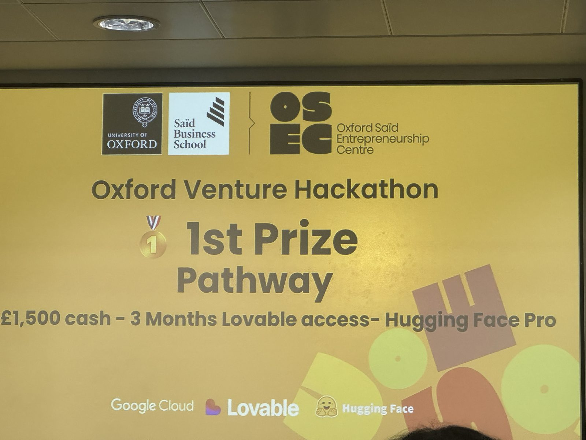
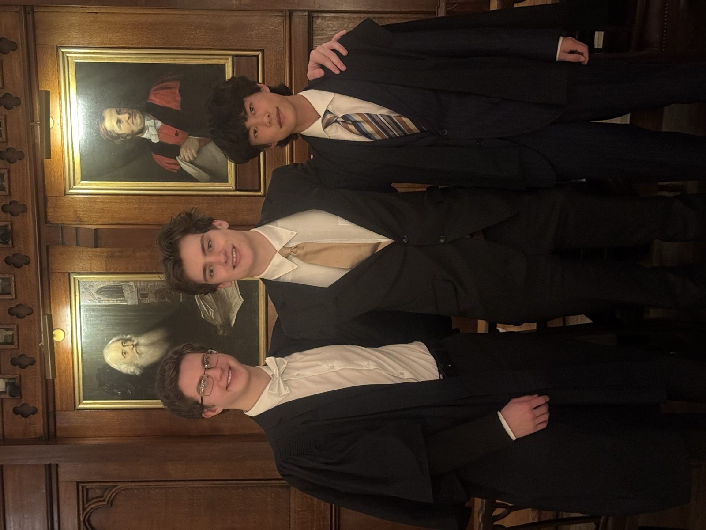
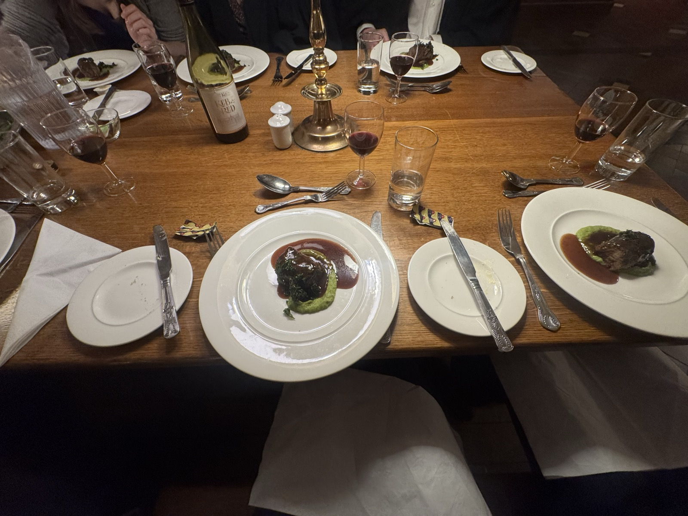

# A borrowed printer, lacrosse sticks, and 36 hours in Oxford

**The story of Pathway, by Jake Smith**
1st Place · Oxford Venture 2026 Hackathon

[Back to the project](../README.md) · [Original demo footage](../README.md#original-hackathon-footage) · [Technical architecture](ARCHITECTURE.md)

I came to Oxford through the **J-StarX entrepreneurship program for Japanese college students**. I expected to learn about building businesses. I did not expect to find myself walking through Oxford at about three in the morning, without having slept, carrying a borrowed 3D printer so that a team I had just met could finish a prototype.

That became one of the most memorable parts of my time there.

## Four people, one problem

Caleb Byrne, Antony He, Aiyush Gupta and I met at the hackathon and formed our team there. We brought different strengths: software architecture, computer vision, CAD, research, product development and pitching. Working together was both inspiring and practical—when one part of the build became difficult, someone else had a way to move it forward.

Our idea was Pathway: explore whether a smartphone mounted on a walking frame could help identify possible obstacles and bring a caregiver into the loop when help might be needed. Reusing a phone and an existing frame gave us a concrete starting point for thinking about accessibility and cost.

We began by sketching the experience and deciding what we could demonstrate within 36 hours.

*An early product sketch. The board records ideas we were considering, not a list of features we completed.*

## Taking the idea outside

I helped lead the user research and concept development. We went out into Oxford to speak with people, rather than relying only on our initial assumptions. Our pitch records **32 street interviews**. The conversations helped us focus on everyday obstacles, indoor use and the importance of keeping caregivers involved.

We also contacted care homes and people who might help us understand the problem or arrange a later demonstration. Expressions of interest were encouraging, but they were not formal partnerships or clinical validation.

<table>
<tr>
<td width="50%"></td>
<td width="50%"></td>
</tr>
<tr>
<td>Listening to people in Oxford helped shape the problem we chose to address.</td>
<td>Turning research and early ideas into a product and pitch structure.</td>
</tr>
</table>

## About 2 a.m.: still no walking frame

There was a fairly fundamental problem with our walking-frame prototype: **we did not have a walking frame**.

We called people we knew and contacted care homes, trying to find one we could borrow. Despite all the outreach, we could not get one in time.

At about **2 a.m.**, we went to a friend-of-a-friend's apartment. He had some old lacrosse sticks and agreed to lend them to us. Those sticks became the basis of our improvised frame, held together with tape and the parts we could make overnight.

It was a demonstration rig, not a mobility aid for someone to rely on. But it gave us a physical structure on which to mount the phone, work through integration problems and show the idea.

## About 3 a.m.: a printer on the streets of Oxford

Another friend had a 3D printer we could borrow. By about **3 a.m.**, we were walking through Oxford with it, still without sleep.

That walk captured something I loved about the experience. People we had only recently met were willing to help us make an idea happen. A conversation led to a borrowed piece of equipment; that equipment made the next part of the build possible. I was discovering Oxford through its people as much as through its buildings and colleges.

Back with the team, we spent the rest of the night designing the phone clips and mount, printing parts, fitting them to the frame and working through the software and hardware together. My contribution included physical prototype integration, testing and troubleshooting ahead of the demonstration, alongside research and the pitch.

<table>
<tr>
<td width="50%"></td>
<td width="50%"></td>
</tr>
<tr>
<td>Working through the build together.</td>
<td>Making the physical prototype from the materials available to us.</td>
</tr>
</table>

## Testing near Saïd Business School

We took the prototype outside near **Saïd Business School, close to Oxford railway station**, and had people try the demonstration. We also tested it ourselves, checking the phone mount, the camera view and how the parts worked together.

These were informal prototype demonstrations and engineering checks. They helped us prepare for the pitch; they did not establish that the system could safely support someone using a walking frame.

*Outdoor prototype testing near Saïd Business School, as recalled from the event.*

## The pitch and the result

After the overnight build, we presented Pathway to the judges. The original demonstration included a simulated fall and a real phone call to the team's phone. The surviving records do not establish whether every step of that contact flow was automatic, so I do not describe it as a recovered autonomous system.

Then came the announcement: **Pathway won first place at the Oxford Venture 2026 Hackathon**.

The result meant a great deal. So did the way we got there: a team formed at the event, conversations with people around Oxford, a borrowed printer, old lacrosse sticks and a lot of shared problem-solving.

<table>
<tr>
<td width="50%"></td>
<td width="50%"></td>
</tr>
<tr>
<td>Presenting the concept, research and prototype.</td>
<td>The first-place announcement.</td>
</tr>
</table>

## The Oxford experience beyond the hackathon

After the pitching and the win, we celebrated at a **Keble College ball**, followed by time at the college bar. It was a memorable end to an intense stretch of work, and another chance to experience Oxford's college culture with new friends.

The friendships were a major part of my J-StarX experience. I left with people I wanted to stay in touch with, an appreciation for the community around us, and a clearer sense of how much I enjoy building with a committed team.

<table>
<tr>
<td width="50%"></td>
<td width="50%"></td>
</tr>
<tr>
<td>New friendships and an introduction to Oxford college life.</td>
<td>A college evening during the Oxford stay.</td>
</tr>
</table>

*These personal photographs document the wider Oxford experience. They are not technical evidence for the prototype or a record of the exact overnight timeline.*

## What I took away

- **Research can change what you build.** Speaking with people gave us more useful direction than staying at the whiteboard.
- **Integration is part of engineering.** Mounting the phone, fitting parts and troubleshooting the demonstration mattered alongside writing software.
- **Resourcefulness depends on people.** The borrowed sticks and printer were possible because someone was willing to help.
- **A good team makes ambitious work possible.** I was inspired by how quickly we learned to work together under pressure.

I am proud of the award. I am equally proud of the effort and relationships behind it.

## About this record

This story combines my recollection, updated in November 2026, with the team's existing photographs and project records. The **2 a.m. lacrosse-stick visit** and **3 a.m. printer walk** are approximate times from my recollection and supersede the earlier account that placed printer collection at 2 a.m.

The original detector and event footage survive. The browser demo was reconstructed later, and the [new iOS implementation remains a separate draft](https://github.com/Jsmitty78/Pathway-Oxford1stPlaceHackathon/pull/1). Neither is presented as the lost original app source. See [reconstruction notes](RECONSTRUCTION_NOTES.md) and [photo provenance](../assets/README.md).
