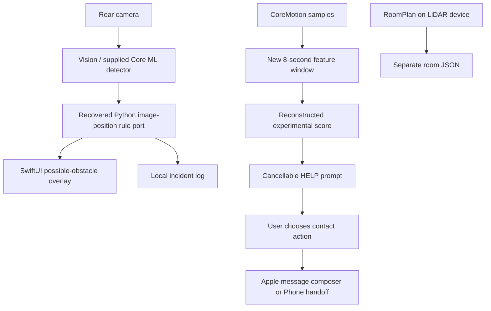

# Architecture and provenance

## Data flow

The demo supplies a synthetic teddy-bear detection. It does not invoke the camera or motion manager and cannot open contact tools. Demo incidents retain their demo marker after changing modes.

## Source map

| File | Responsibility |
|---|---|
| `Sources/PathwayCore/PathwayCore.swift` | Detection rule, bounded motion window, HELP state transitions and JSON incident serialization |
| `PathwayApp/AppModel.swift` | UI state, incident persistence, cooldowns, recording and contact configuration |
| `PathwayApp/CameraService.swift` | Authorized rear-camera capture, throttled Vision requests and portrait preview |
| `PathwayApp/MotionService.swift` | Device motion at requested 50 Hz; gravity-inclusive acceleration and radian-based gyro values |
| `PathwayApp/RoomScanner.swift` | RoomPlan session, availability guard and processed-room JSON export |
| `PathwayApp/ContactComposer.swift` | User-controlled message composer and result reporting |
| `PathwayApp/PathwayApp.swift` | Monitor, settings, incident log and HELP screens |

## What is original and what is new

The axis-aligned hazard test ports the surviving Python `isHazard`: confidence strictly greater than 0.5, top of box below 15% of image height, bottom below 65%, excluding person/bed/suitcase/couch. Input boxes are normalized to top-left origin. Malformed-input rejection is new. Rotated-box fallback and all-class display are not ported.

Motion weights/ranges are adapted from the browser reconstruction, not the lost iOS detector. Vector angular-acceleration extraction, angular wrapping and rolling-window timing are new. Motion units are total acceleration in g, rotation in rad/s and attitude in radians; scoring converts angular units to degrees. Post-event stillness is approximated by the trailing quiet interval. The window does not prove a causal fall sequence.

The interface borrows the camera-first view, obstacle highlight, HELP control and dated log from the original footage. Its layout and interactions are new. There is deliberately no live steering arrow: the current pipeline has no verified depth, free-space map or safe-route computation. A 2D low-in-image heuristic cannot establish that an object is on the floor.

RoomPlan does not recover low rug edges or automatically join with camera tracking. Its JSON is a separate scan artifact, not a navigation map. Camera monitoring pauses during scanning to avoid simultaneous camera ownership.

## Lifecycle and persistence

Monitoring runs only in the foreground and pauses when the scene becomes inactive. Returning to the app requires Start. Motion buffers reset when starting/stopping. Camera work is serialized on a dedicated queue; the UI receives updates on the main queue. Hazard incidents have a 10-second cooldown; motion-triggered help has a 30-second cooldown after a prompt/cancellation. Cooldowns are UX choices, not validated sensitivity settings.

A HELP countdown uses an absolute deadline. Cancellation cannot later transition to ready. Expiry only reveals contact options. Calls are recorded as app handoffs; a composer result of sent is not a delivery receipt.

Incident writes are atomic. Corrupt existing logs are preserved and reported rather than overwritten. The app keeps at most 500 incidents. Trace exports use temporary files; room scans persist in Documents/Rooms. No images, audio, location coordinates or credentials are collected. The caregiver phone number is stored in local preferences; exports may include personally identifying room labels and should be reviewed before sharing.
